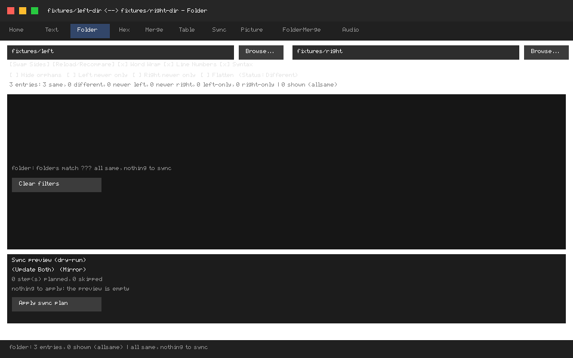

# REPORT — Wave BG-ALLSAME (micro)

Tareekh: 2026-11-20 UTC
Workspace: /Users/ektasaini/autocompare (branch main, pull already up-to-date)
Scope: sirf OWNS — `crates/gui/src/screenshot.rs` + `checks/gui-allsame-bg/**`
(`views.rs`/`app.rs`/`tree.rs` read-only, koi paint/classifier edit nahi)
Harness: `tools/gui-polish/run-geo-typo.sh` + `target/debug/autocompare-gui --screenshot` (offscreen)

## Summary

BF REPORT S4 P2-1 (AllSame headless fixture scene) CLOSE. Accent-scene
precedent par dispatcher me `allsame` route + `render_folder_allsame_fixture_png`
joda: do same folders (3 rows, sab `=`), diff-seeking `Different` filter ped
khaali karta hai (`visible == 0`), panel live paint wiring
(`folder_paint_empty_hint_full_rows`) se AllSame hint deta hai. Wiring pehle
se live thi — yeh wave sirf headless PNG proof deti hai, paint ko chhua nahi.

## Files changed (sirf OWNS)

- `crates/gui/src/screenshot.rs` (+311/-1):
  - Dispatcher: `allsame` check accent ke baad, folder checks se pehle +
    doc-comment me route darj.
  - `render_folder_allsame_fixture_png`: rows identical, display
    `status: Different`, `shown = folder_tree_filtered(...).len()` (= 0),
    hint paint helper se, Clear affordance (`display.is_active()` par — live
    `paint_folder` early-return jaisa), sync panel folder-empty precedent par.
  - 3 naye tests: `allsame_fixture_renders_valid_png`,
    `allsame_scene_matches_allsame_contract`,
    `dispatcher_routes_allsame_scene`.
- `checks/gui-allsame-bg/GATES.md`, `REPORT.md` (yeh file),
  `round-1/after-allsame.png` + `round-1/after.png`.

## Build + harness proof

- `cargo test -p autocompare-gui`: **584 passed, 0 failed**
  (BF 581 + 3 naye). Padosi suites (`app.rs` AllSame asserts, `views.rs`
  `_full_rows` asserts, `tree.rs` classifier asserts) green — regression nahi.
- `cargo clippy -p autocompare-gui --all-targets`: zero warnings.
- `cargo fmt -p autocompare-gui`: clean; `git status` me sirf OWNS paths.
- `zsh tools/gui-polish/run-geo-typo.sh checks/gui-allsame-bg/round-1`
  (sidecar `.out`/report files commit nahi — sirf dono PNG rakhe):
  `RESULT: PASS` — geometry `Grid::10`, `text_style_height x4`, 25 width
  calls, add_space none; typography `monospace x53`, `strong x23`,
  `small x50`, `.size values ['14.0']` (legacy numeric reference, koi naya
  numeric size nahi); colors info-only (koi paint edit nahi).

## PNG verify (magic + size + distinct)

Sab `PNG image data, 960x600, 8-bit/color RGBA, non-lace`. Magic
`89504e470d0a1a0a` ok, dono >= 8192 B, distinct > 64 (blank nahi):

| file | bytes | md5 (short) | twin | same? |
|---|---|---|---|---|
| after.png (text) | 9695 | 35d69828 | BF BE twin 35d69828 | haan (default scene unchanged — regression-absence) |
| after-allsame.png | 10264 | 36adfef2 | NAYA (BF/BB me tha hi nahi) | naya scene |
| after-folder.png (temp) | 10068 | bb877286 | BB twin bb877286 | haan (fixture ko chhua nahi) |
| after-folder-empty.png (temp) | 10081 | 57bc3486 | BB twin 57bc3486 | haan (fixture ko chhua nahi) |

after-allsame teeno (text/folder/folder-empty) se byte-distinct hai;
do-run twin byte-identical (deterministic). Temp folder PNGs round dir me
commit nahi — sirf `after.png` + `after-allsame.png`.

 

## P2-1 closure evidence

- `visible == 0`: `Different` filter sirf `!` rakhta hai — 3 `=` rows prune,
  `folder_tree_filtered(...).len() == 0` (test me assert).
- all-same: `folder_empty_state_full_rows(true, rows, 0, display) ==
  Some(AllSame)` (test me assert; `app.rs`/`views.rs` live asserts se match).
- Hint paint wiring se: `folder_paint_empty_hint_full_rows(rows, 0, display)`
  `"all same"` + `"nothing to sync"` rakhta hai, idle (`NoResults`) aur
  pruned (`FilterPruned`) hints se alag hai, `"clear filters"` nahi deta
  (test me assert). Fixture panel wahi string draw karta hai.

## Honest notes

- Headless 5x7 font me live hint ka em-dash (U+2014, `"match — all"` wala)
  3 fallback `?` glyphs me render hota hai (`draw_string` bytes chalata hai,
  `glyph_pattern` catch-all `?` outline deta hai). Live egui me dash sahi
  dikhta hai; headless artifact hai, wording proof par asar nahi (test live
  string par hai, pixels par nahi).
- Sync panel folder-empty precedent mirror karta hai (filter display prune
  karta hai, plan nahi); identical rows par steps khaali, consent line
  `"nothing to apply"` wali hai — live helpers ka verbatim output.
- Colors FROZEN: diff me `Color32::from_rgb`/`Visuals::` 0 adds.

## Rule follow proof

- `git status --porcelain`: sirf `M crates/gui/src/screenshot.rs` +
  `?? checks/gui-allsame-bg/` (round dir me sirf 2 PNG).
- `checks/opencode-waves/STATUS.md` untouched (orchestrator-owned).
- `views.rs`/`app.rs`/`tree.rs` me zero edit (read-only use).
- Commit conventional English message, NO PUSH (orchestrator verify + push karega).
