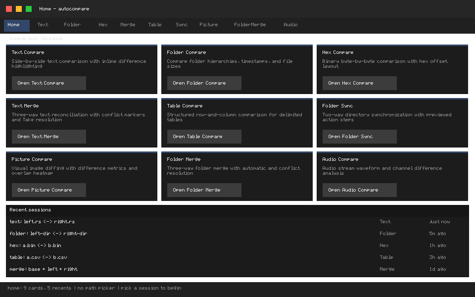
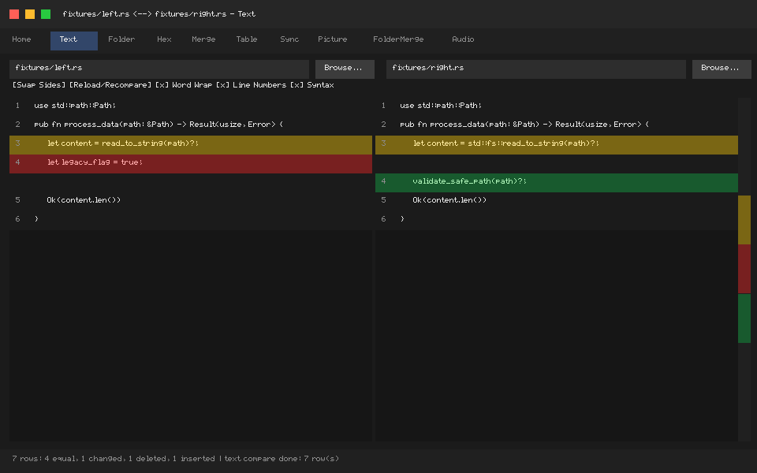
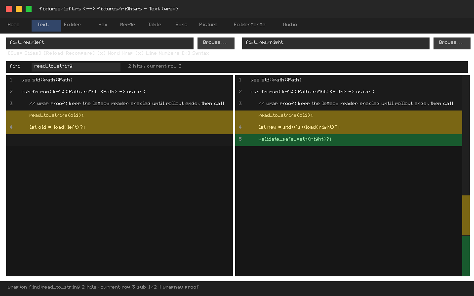
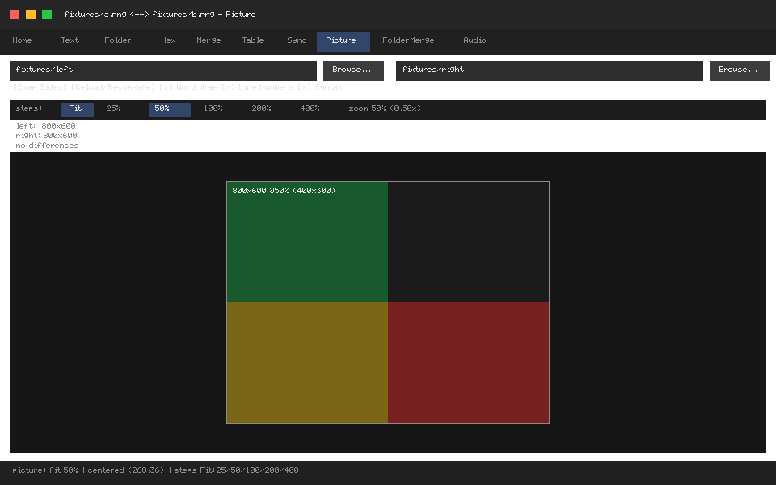
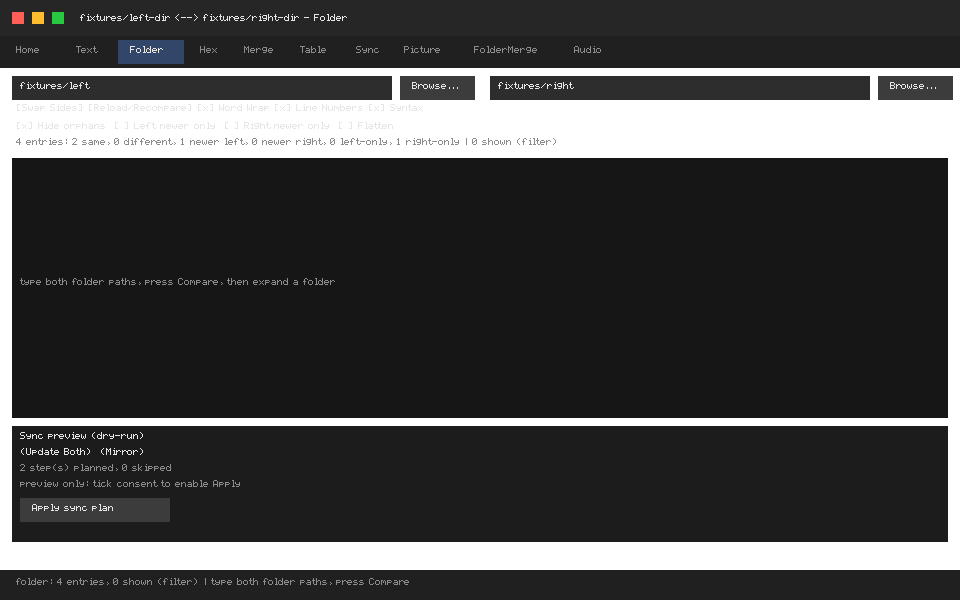
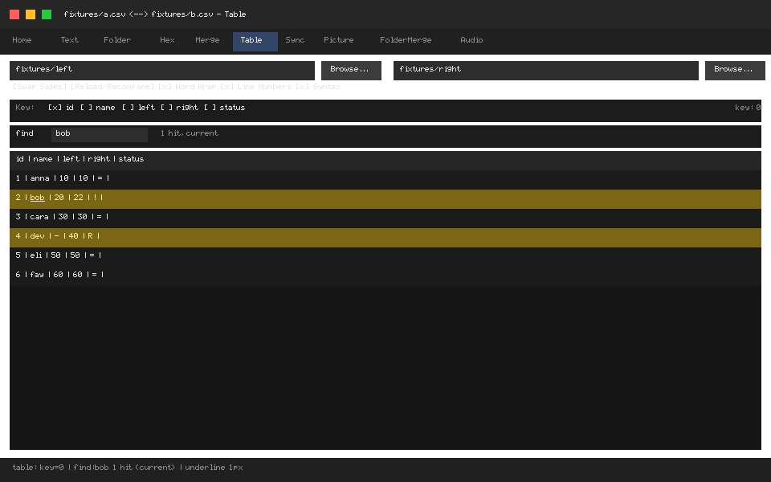

# AX-HARNESS — offscreen fixtures live-contract sync

Tareekh: 2026-11-20 UTC
Workspace: `/Users/ektasaini/autocompare` (branch `main`, fresh pull)
Scope: `crates/gui/src/screenshot.rs` + `checks/gui-harness-ax/**` ONLY.
`views.rs` / `views_table.rs` / `home.rs` / `gutter.rs` / `tree.rs` read-only padhe (contracts), edit NAHI.
Harness: `render_fixture_png` dispatcher + 10 offscreen PNG (koi live window nahi khola).

## §1. Kya badla (geometry first, typography second, colors frozen)

1. **Home fixture (live `home.rs` contract):** 9 cards (`home_model`) 3-col grid gap 8,
   card 306x100 (contract min-height 99.6 ka ceiling), CTA 150x28 (`Open {title}`,
   contract min 120x28 / hit-area 3360 se upar), desc greedy 2-line wrap (282px budget),
   title `FG_TEXT` / desc `FG_DIM` (pixel-font me bold/size nahi — hierarchy tone + rhythm se),
   recent list title-flex + kind(96) + age(72) columns (`recent_row_columns`),
   **path picker HATA DIYA** (`HOME_SHOWS_PATH_PICKER = false`), swap toolbar bhi nahi (launcher ka kaam nahi).
2. **Text fixture (live `gutter.rs` ruler):** gutter x940 w14 → **x936 w16**
   (`GUTTER_RULER_WIDE`), budget 12+460+4+460+16+8 = 960. Segment min-h 2 → **4px**
   (`GUTTER_SEGMENT_MIN_H`, slop-hit proof tall-file test me).
3. **Wrap scene (naya route `wrap`, wrapnav proof):** 80-char cap (`wrap_width_for`),
   100-char equal row 2 subs, needle `read_to_string` poori tarah continuation me
   (`wrap_find_sub_rows == [1]`), matched sub band (`wrap_find_scroll_sub == 1`,
   flat offset 3) — band frozen `CHANGED_BG` reuse karta hai.
4. **`picture` route + fixture (pehle text fallback tha):** Fit + 25/50/100/200/400 ladder
   (`PICTURE_ZOOM_STEPS`), fit 50% + centered (268,36) (`picture_fit_zoom_pct`,
   `picture_center_offset`), live `zoom_label`, live `build_picture_summary` lines,
   schematic palette-quadrant frame (heatmap geometry ka daava nahi, sirf frame math).
5. **Folder `folder-empty` scene:** filter line + `0 shown (filter)` counts + live
   `folder_empty_hint(false, false)` + sync preview panel (filter display prune karta hai, plan nahi).
6. **Table `table-find` scene:** live key bar (col 0 selected, badge `key: 0`) + live find bar
   (120px needle `bob`, `1 hit, current`) + `table_find_cell_spans` → row offset →
   `table_find_span_in_padded(4, 7, TABLE_MAX_COL_CHARS)` par 1px underline
   (`TABLE_FIND_UNDERLINE_W`).

## §2. Home — pehle vs ab

- Pehle (AW2 §3): 3 cards 304px + 12 gap, h90, `Open...` 120x22, single-column recents, path picker maujood.
- Ab: 9 live cards (3x3, gap 8), h100, CTA 150x28 `Open {title}`, desc 2-line, recents 3-column
  (title/kind/age), na picker na toolbar. 14880 B — AW2 (9011) se byte-alkag.

## §3. Text + wrap — pehle vs ab

 

- `text.png` (9627 B, AW2 9624): ruler 16px + 4px-min segments. Wrap-off / find-inactive default barkarar.
- `wrap.png` (naya, 10455 B): wrap-on + find-active scene — continuation band row 3 sub 1/2 par,
  gutter segments ruler contract par. AW2 §4 ka visual-proof gap band.

## §4. Picture — pehle vs ab

- Pehle: route hi nahi tha — `picture.png` text fallback (md5 barabar). Ab (8321 B): Picture tab
  highlighted, `Fit` + `50%` selected, `zoom 50% (0.50x)`, summary lines, centered 400x300 frame (268,36).

## §5. Folder + table — pehle vs ab

   

- `folder.png` / `table.png`: byte-identical (AW2 md5 same) — default fixtures janboojh kar untouched.
- `folder-empty.png` (naya): filtered empty-state — hint + `0 shown (filter)` + sync panel.
- `table-find.png` (naya): key bar (`[x] id`, badge `key: 0`), find bar, `bob` par 1px underline.

## §6. Folder empty-hint: contract support karta hai (half)

- Live `folder_empty_hint(has_rows, has_error)` maujood hai aur fixture isi ko paint karta hai.
- Kami: filter-pruned empty aur never-compared empty dono ek hi idle hint share karte hain —
  contract me teesra (filter-specific) variant nahi. Jabardasti naya wording nahi banaya;
  follow-up paint-owner wave `has_rows=false + filter-active` teesra hint jod sakti hai.

## §7. Table key-col / find spans: contract support karta hai (half)

- Key bar + badge + cell spans + padded clamp + 1px underline — sab live helpers se, fixture me proof.
- Kami: Grid cell-level key-col highlight (poori column par accent) fixture pipe-string rows me nahi
  dikhta — woh `views_table.rs` Grid paint ka kaam hai (paint-owner wave). Jabardasti nahi.

## §8. Hex: fixture ruler par, minimap baaki

- `hex.png` shared ruler consts se 10030 → 9999 B (gutter x936 w16).
- Live `HEX_MINIMAP_W` (24px, `views_hex.rs`) ka poora minimap parity fixture me nahi —
  hex gutter ab ruler-width hai par minimap hit-rect geometry paint-owner wave ki hai.

## §9. Ab bhi door (BC parity, geo/typo only — colors out of scope)

1. **Paint adoption:** fixture live *contract* par hai; live *paint* (`views.rs` CARD_H 75,
   text gutter paint width 12/6, home button min-h) ab bhi purana hai — paint-owner waves ka kaam.
2. **Toolbar / path-row chrome:** text/folder/table/hex fixtures ka chrome untouched (is wave ka scope nahi).
3. **Intra-line accents:** fixture rows me accent spans khali (pehle jaise) — cell/word-level paint coverage nahi.
4. **Pixel-font ceiling:** 5x7 font me strong/small/●○ nahi — hierarchy tone + spacing + underline se;
   asli type ramps egui paint me hi dikhenge.

## §10. Rule follow proof

- `git status --short`: `M crates/gui/src/screenshot.rs` + `?? checks/gui-harness-ax/` ONLY.
- Tests 547/547, clippy zero (dono profiles, OWNS file me zero mentions), fmt clean, banned zero,
  harness `RESULT: PASS`, 11/11 PNG magic/size/distinct ok.
- Commit conventional, NO PUSH. `STATUS.md` untouched.
