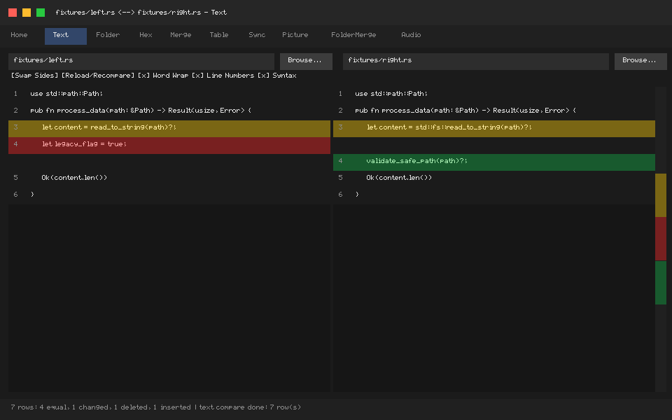

# BD-HEXPURE — Hex minimap hit-rect + nibble accent pure geometry (views_hex.rs ONLY)

Tareekh: 2026-11-20 UTC
Workspace: `/Users/ektasaini/autocompare` (branch `main`, pull fresh — `Already up to date`)
Scope: `crates/gui/src/views_hex.rs` + `checks/gui-hexpure-bd/**` ONLY — `views.rs`,
`app.rs`, `tree.rs`, `theme.rs`, `screenshot.rs` read-only (parallel waves lock), zero edit.
Harness: `zsh tools/gui-polish/run-geo-typo.sh checks/gui-hexpure-bd/round-1` → `RESULT: PASS`.
Precedent: `checks/gui-hexmini-ay/REPORT.md` (nibble-parity pattern follow kiya).

Goal (localrun-bb REPORT §4 P1-2): 24px minimap hit-rect + nibble-level changed-accent
geometry ko pure helpers (contract tokens + rect math + unit tests) ke roop me lao.
AY ne tuple layer di thi (`hex_minimap_bands`, `hex_diff_nibble_cells`); ye wave usko
track-anchored `egui::Rect` math tak poora karti hai taaki agla paint wave inline
first/last/y0/y1 loop aur `??` whole-row marks ko seedha replace kar sake.

## §1. Kya badla (views_hex.rs, +475 lines, sab pure headless, zero deletions)

**Minimap contract tokens (paint lock):**
- `hex_minimap_alloc_height()` — 220.0, paint `views::HEX_MINIMAP_H` se equality lock.
- `hex_minimap_alloc_size()` — `vec2(strip_width, alloc_height)` = `(24, 220)`,
  paint ke `allocate_exact_size(vec2(bar_w, HEX_MINIMAP_H))` ka headless judvaan.
- `hex_minimap_track_rect(origin)` — `from_min_size(origin, alloc_size)`: yehi 24px
  hit-rect hai (allocate rect + click/drag sense isi par).

**Minimap rect math (paint seg parity):**
- `hex_minimap_band_rect(track, total_rows, hunk)` — AY `hex_minimap_band_for_hunk`
  fractions ko `track.min.y` par anchor, `track.max.y` par clamp; x me poori track
  chaudai. Floor wahi `GUTTER_MIN_SEGMENT_H` (= paint `ROW_PAD`, 2px). Zero-area ya
  non-finite track, khali run, row-se-bahar par `None`.
- `hex_minimap_band_rects(track, total_len, hunks)` — poori list offset order me,
  tuple layer (`hex_minimap_bands`) se y-parity lock.
- `hex_minimap_row_at_pos(track, total_rows, pos_y)` — track-relative hit mapping,
  paint `hex_minimap_row_at_y(pos.y - rect.min.y, rect.height(), total)` ka judvaan,
  wahi `None` contract. `hex_minimap_y_for_row` ke saath round-trip lock.

**Nibble changed-accent rects (poori-row se aage):**
- `hex_nibble_cell_rect(row_rect, col)` — row rect ke 16 barabar columns me `col` wala
  hissa; `col >= 16` ya zero-area par `None`.
- `hex_nibble_accent_rects(cell_rect, cell)` — `(high, low)`: high = cell ka left
  aadha, low = right aadha; sirf alag nibble par `Some`, barabar par `(None, None)`.
- `hex_row_nibble_accent_rects(row_rect, cells)` — sab alag halves col order me;
  barabar row par khali vec (paint ko poori-row band lagane ka koi kaaran nahi).

Koi naya token/color nahi: width gutter se, height paint token se, floor
`GUTTER_MIN_SEGMENT_H` se, typo `Mono` se. Non-test code me `unwrap/expect/panic/todo`
zero; apne diff me `Color32|Visuals` zero (AY wale "nahi" comments bhi nahi rakhe).

## §2. Gates green proof

- `cargo test -p autocompare-gui`: **578/578** (7 naye BD tests: alloc-tokens, band-rect,
  band-rects, row-at-pos, cell-rect, accent-rects, row-accent-rects).
- `cargo clippy -p autocompare-gui --all-targets`: views_hex hits **zero** (ek `dead_code`
  warning sibling wave ke `views.rs` folder hint ka hai — is wave ne use chhua nahi).
- `rustfmt --edition 2024 --check crates/gui/src/views_hex.rs`: **clean** (sirf apni file
  par chalaya; deletions zero — `grep -c '^-[^-]'` = 0, sirf insertions).
- Banned apne diff me: `unwrap\(|\.expect\(|panic!|todo!|unreachable!` **zero**,
  `Color32|Visuals` **zero**.
- Harness round-1: `RESULT: PASS` (PNG 9627 B, magic `89504e470d0a1a0a` ok, distinct 256).

## §3. Rule follow proof

- OWNS se bahar zero edit: `views.rs` / `app.rs` me `M` status sibling P0-1 folder wave ka
  pehle-se-maujood kaam hai (is wave ke diff me unka naam nahi aayega — commit pathspec
  sirf apni 3 paths par hai). `STATUS.md` untouched. Colors FROZEN.
- Commit conventional English message, NO PUSH (orchestrator verify karke push karega).

## §4. Agle wave ke liye EXACT callsite wiring spec (views.rs, is wave me LOCKED — no edit)

Neeche har mapping me purani lines (aaj ke `main` par, sibling folder hunk se pehle ka
hex block shift nahi hua) + naya call + args. Paint wave sirf ye replacements kare,
koi geometry dobara na gine.

1. Strip allocate (views.rs line ~1254 `let bar_w = HEX_MINIMAP_W;` + line ~1255-1258
   `allocate_exact_size(vec2(bar_w, HEX_MINIMAP_H), ...)` + line ~1259 `debug_assert_eq!`):
   - `bar_w` ki jagah `views_hex::hex_minimap_strip_width()` (AY lock pehle se green).
   - Height arg `HEX_MINIMAP_H` ki jagah `views_hex::hex_minimap_alloc_height()`.
   - `debug_assert_eq!(rect.width(), views_hex::hex_minimap_strip_width())` rakhe —
     BD test alloc-size lock ki wajah se green rehta hai.

2. Band loop (views.rs line ~1265 `let step = ...HEX_BYTES_PER_ROW...` se line ~1287 `}` tak
   ka `for hunk in view.hunks.iter()` + `first/last/y0/y1/seg/rect_filled` block):
   - Poore loop ki jagah:
     `for seg in views_hex::hex_minimap_band_rects(rect, view.left_size.max(view.right_size), &view.hunks) { ui.painter().rect_filled(seg, 0.0, CHANGED_BG); }`
   - `step`, `run`, `first`, `last`, `y0`, `y1`, `hex_minimap_seg_end` locals delete;
     track rect + `CHANGED_BG` frozen rehte hain. `hex_minimap_seg_end` fn untouched
     (doosri jagah use nahi hota to dead-code allow agla wave dekhe).

3. Click/drag jump (views.rs line ~1288-1294 `minimap_pressed ... hex_minimap_row_at_y(
   pos.y - rect.min.y, rect.height(), total)`):
   - Row mapping ki jagah:
     `views_hex::hex_minimap_row_at_pos(rect, total, pos.y)` (args: track rect, total rows,
     absolute pointer y — local subtract andar hai). Baaki `hex_minimap_jump_to_row(
     view, pager, row)` call same rehta hai.

4. Nibble accent (views.rs line ~1319 `Grid::new("hex_byte_grid")` + line ~1323-1328 row loop
   jahan `(addr, hex, ascii) = format_hex_grid_cells(row, &view.hunks)` se 3 labels paint hote hain):
   - Har visible `row` ke liye caller-side byte slices par
     `views_hex::hex_diff_nibble_cells(row, left, right)` (AY helper; slices App/engine side
     se aayengi — model me byte values nahi, OPEN wiring AY REPORT §2 point 3 jaisa).
   - Row rect (Grid cell layout se mila `Rect`) + cells par
     `views_hex::hex_row_nibble_accent_rects(row_rect, &cells)` se accent rects;
     har rect par `rect_filled(accent, 0.0, CHANGED_BG)` — colors frozen, geometry BD se.
   - Khali vec = row me koi antar nahi → poori-row accent skip (yahi P1-2 ka asal fix hai).
   - Typo: cells `views_hex::hex_nibble_text_role()` = `Mono` (koi naya role nahi).

