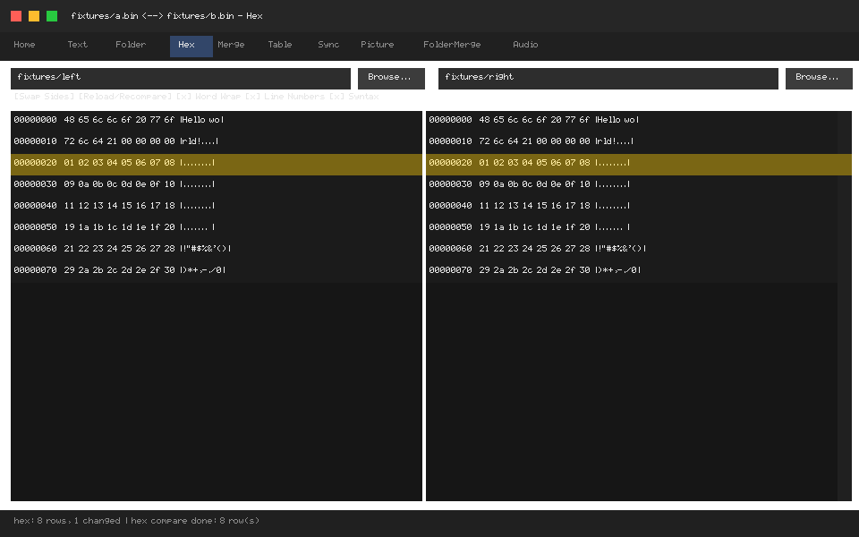

# BI-HEXTEXT — Hex grid-cell real digits (localrun-bh REPORT §4 P1-1 close)

Tareekh: 2026-11-20 UTC
Workspace: `/Users/ektasaini/autocompare` (branch `main`, pull fresh — `Already up to date`)
Scope: `crates/gui/src/views_hex.rs` (grid-text scope only) + `checks/gui-hextext-bi/**`.
`views.rs` callsite FROZEN (zero edit), `app.rs` snap FROZEN, `screenshot.rs` READ-ONLY
(paint logic nahi), `tree.rs`/`theme.rs`/`views_table.rs` READ-ONLY,
`checks/opencode-waves/STATUS.md` untouched. Colors FROZEN.
Harness: `zsh tools/gui-polish/run-geo-typo.sh` + `--screenshot` (offscreen, koi live window nahi khola).
Precedent: `checks/gui-hexpure-bd/REPORT.md` (pure-helper pattern) + `checks/gui-nibble-bg/REPORT.md`
(scope note: callsite-only wave ne grid text ko agle paint wave par chhoda tha).

## §1. Kya badla (views_hex.rs, +193 lines, sab pure headless, zero deletions)

Goal (localrun-bh §4 P1-1): `format_hex_grid_cells` (offset/len-only) `??` marks banata hai;
accent-rect plumbing + callsite slices pehle se live hain (BG-nibble `685d9ad`), sirf grid text
baaki tha. Ye wave uska pure judvaan `views_hex.rs` me laati hai — `views.rs` FROZEN hai, isliye
paint wiring agle wave ka kaam hai (spec §5 me).

**Grid-text helpers (paint-ready, test-only until wiring):**
- `hex_grid_covers_offset(offset, hunks)` — `views::hunk_covers_offset` ka local judvaan
  (views_hex views par depend nahi kar sakta, same range semantics
  `[offset, offset + max(left_len, right_len))`).
- `hex_grid_cell_byte(offset, left, right)` — left prefer, missing par right fallback
  (insertion hunk honest: jo side maujood hai uske digits), dono missing par `None`.
- `hex_grid_ascii_mark(byte)` — printable `0x20..=0x7E` wahi char, warna `.` (fixture style).
- `format_hex_grid_cells_with_bytes(row_start, left, right, hunks)` — wahi 3-cell shape
  (ruler address, 16-byte hex, 16-char ASCII), wahi midline gap, wahi blank uncovered slots;
  sirf covered `??` ki jagah real lowercase digits aur covered `?` ki jagah real ASCII.
  `hex.len()` purane shape se barabar rehta hai (Grid chaudai stable).
- `format_hex_grid_row_with_bytes(row_start, left, right, hunks)` — wahi single-string join
  jo Grid paint cells me banta hai (logs/tests ke liye, `format_hex_grid_row` precedent).

Koi naya token/color nahi: ruler `format_hex_offset` reuse, typo `Mono` (paint side pehle se
`hex_nibble_text_role`), floor/palette untouched. Non-test code me `unwrap/expect/panic/todo`
zero; apne diff me `Color32|Visuals` zero (comment me bhi nahi — BD precedent).

## §2. Gates green proof

- `cargo test -p autocompare-gui`: **591/591** (589 purane + 2 naye: real-digits, fallback-parity).
- `cargo test` full workspace: **exit 0**, koi FAILED suite nahi (gui 591 samet sab ok).
- `cargo clippy -p autocompare-gui --all-targets`: **zero warnings** (ek `iter_nth_zero`
  test-line pakdi gayi thi — `.chars().next()` se fix).
- `rustfmt --edition 2024 --check crates/gui/src/views_hex.rs`: **clean** (sirf OWNS file
  par; bare `cargo fmt` MANA, chalaya nahi).
- Banned apne diff me: `unwrap\(|\.expect\(|panic!|todo!|unreachable!` **zero**,
  `Color32|Visuals` **zero**. Deletions: `grep -c '^-[^-]'` = **0** (sirf insertions).
- KEVL diff absent: `views.rs` / `app.rs` / `screenshot.rs` / `tree.rs` / `theme.rs` /
  `views_table.rs` / `STATUS.md` me zero edit.

## §3. PNG verify (magic + size + dimensions)

Harness: `zsh tools/gui-polish/run-geo-typo.sh checks/gui-hextext-bi/round-1` →
`RESULT: PASS` (exit 0). Signals BF/BG se exact-match:
geometry `Grid::10`, `text_style_height x4`, 25 width calls, add_space none;
typography `monospace x53`, `strong x23`, `small x50`, `.size values ['14.0']`.

| file | bytes | magic | distinct | remark |
|---|---|---|---|---|
| after.png (text fixture) | 9695 | ok | 255 | BH twin se byte-identical (text fixture untouched, expected) |
| after-hex.png (hex pixel-fixture) | 9999 | ok | 256 | BG twin se byte-identical (fixture route read-only, expected) |

Dono `PNG image data, 960x600, 8-bit/color RGBA`, magic `89504e470d0a1a0a` ok, dono >= 8192 B, non-blank.

## §4. Honest notes (kya verify nahi ho sakta tha)

- PNGs me grid-text delta nahi dikhta: `after.png` text fixture hai aur `after-hex.png`
  pixel-drawn fixture hai (`screenshot.rs` READ-ONLY) — dono me live `paint_hex` chalta hi nahi,
  aur headless me koi real compare bhi nahi chalta (snap `None` = purana fallback). Isliye
  PNGs regression-absence proof hain; grid-text ka visual proof unit tests + shape-parity
  asserts hain (naya `hex.len()` purane shape se barabar). Live-egui par do alag bytes wali
  files ka compare chalate hi real digits lagenge — uska gate agle live wave ka hai.
- Kaunsi side dikhe: grid single-column hai (per-side do grid nahi), isliye left-prefer +
  right-fallback. Dono sides alag hone par left digits dikhte hain aur nibble accent rects
  (pehle se live) antar bhi dikhate hain — jhooth kabhi nahi: dono missing par blank.
- TOCTOU (BG honest note stands): snap compare ke baad dobara padha jata hai; beech me badli
  file par digits stale ho sakte hain — par agla Compare snap refresh karta hai aur nakam
  read khali slices deta hai (blank, kabhi galat digits nahi).
- Colors: poori tarah out of scope — diff me palette/Visuals zero adds (sirf pehle-se-maujood
  `CHANGED_BG` reuse paint side par, is wave me koi paint edit nahi).

## §5. Agle paint wave ke liye EXACT callsite wiring spec (views.rs, is wave me LOCKED — no edit)

Neeche mapping me purani lines (aaj ke `main` par) + naya call + args. Paint wave sirf ye
replacement kare, koi geometry dobara na gine. Koi naya token/color nahi.

`views.rs` line ~1383 (`egui::Grid::new("hex_byte_grid")` row loop jahan
`(addr, hex, ascii) = format_hex_grid_cells(row, &view.hunks)` se 3 labels paint hote hain):
- Us line ki jagah:
  `let (addr, hex, ascii) = views_hex::format_hex_grid_cells_with_bytes(row, left_slice, right_slice, &view.hunks);`
  (`left_slice`/`right_slice` wahi hain jo line ~1393-1396 `match hex_bytes` se nikalte hain —
  accent-rect path ke liye pehle se live, isliye koi naya slice plumbing nahi chahiye).
- Baaki Grid paint same rehta hai (`nibble_role.rich(...)` labels, `end_row`, spacing tokens
  `SECTION_GAP`/`TIGHT_GAP` frozen). Khali vec/shape-parity ki wajah se Grid chaudai nahi hilti.
- Typo: cells pehle se `hex_nibble_text_role()` = `Mono` par paint hote hain (koi naya role nahi).
- `format_hex_grid_cells` (offset-only) aur `format_hex_grid_row` untouched rehte hain
  (back-compat logs/tests); naya join `format_hex_grid_row_with_bytes` wahi shape deta hai.

 
