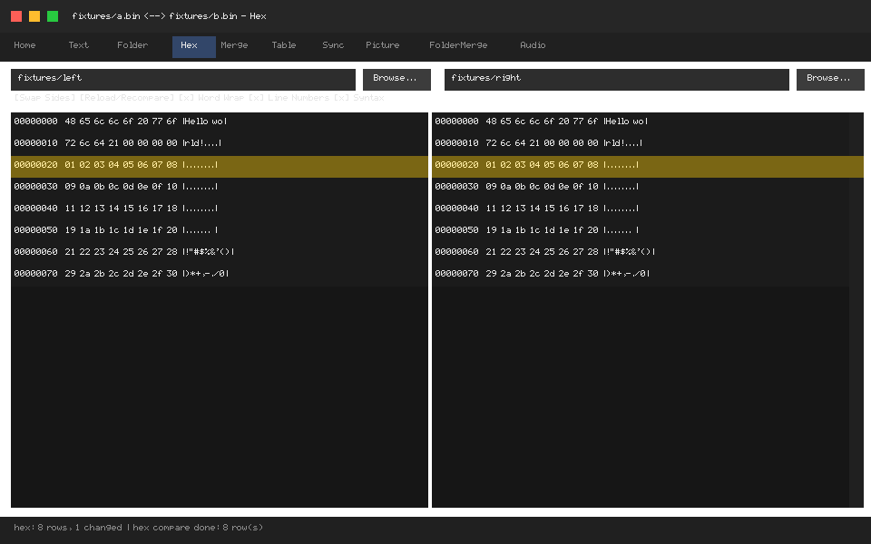

# BG-NIBBLE — Hex nibble-content data threading (BF §4 P1-1 close)

Tareekh: 2026-11-20 UTC
Workspace: /Users/ektasaini/autocompare (branch main, pull already up-to-date)
Scope: `crates/gui/src/views.rs` (callsite only) + `crates/gui/src/app.rs`
(hex state threading) + `checks/gui-nibble-bg/**`. `views_hex.rs` FROZEN,
`screenshot.rs` READ-ONLY, `tree.rs`/`theme.rs`/`views_table.rs` READ-ONLY,
`checks/opencode-waves/STATUS.md` untouched. Colors FROZEN.
Harness: `tools/gui-polish/run-geo-typo.sh` + `--screenshot` (offscreen, koi live window nahi).

## 1. Kaam (BF §4 P1-1 OPEN hissa — ab CLOSED)

`paint_hex` me `hex_diff_nibble_cells(row, &[], &[])` hamesha khali slices
deta tha, isliye changed-nibble accent rects kabhi paint nahi hote the.
Geometry + rect helpers pehle se live the (BD wave) — sirf data plumbing baaki thi.

- `app.rs`: naya App-owned `HexByteSnap { left, right }` (aligned engine cap
  tak dono inputs) + `as_slices()` + capped readers (`read_hex_input_capped` /
  `read_hex_inputs_capped`: missing/unreadable/over-cap par khali, kabhi panic
  nahi). `CompareResult::Hex` ab `(lines, view, Option<HexByteSnap>)` carry karta
  hai — background job compare ke baad dono files dobara padhta hai (capped).
- `app.rs` lifecycle: `set_hex_success` snap adopt karta hai; `clear_hex_results`
  (model + view + snap, mode/max_hunks rakh kar) har wipe site par hai —
  restore-tab, swap, `set_hex_mode`, require-paths fail, Hex Err. Purani bytes
  kabhi stale hunks ke saath nahi rehti.
- `views.rs` callsite only: `paint_hex` ko 5va arg `hex_bytes:
  Option<(&[u8], &[u8])>`; `match` se REAL slices ya `(&[], &[])` fallback, phir
  `hex_diff_nibble_cells(row, left_slice, right_slice)` + wahi
  `hex_row_nibble_accent_rects` rects par `CHANGED_BG` (frozen). Signature change
  ka ek hi caller hai (`app.rs` paint site) — repo me koi aur `paint_hex(`
  caller nahi.
- `views_hex.rs` me ZERO change (helpers frozen-ready the, wahi use hue).

## 2. Gates green proof

- `cargo test -p autocompare-gui`: **589 passed, 0 failed** (5 naye: snap-slices,
  none-fallback, success+clear, swap-clear, capped-read; purane mode-change test
  me snap-clear assert juda).
- `cargo test` full workspace: **43 suites ok, koi FAILED nahi**.
- `cargo clippy -p autocompare-gui --all-targets`: **zero warnings** (ek
  `indexing_slicing` test-line pakdi gayi thi — `.first()` + `is_some_and` se fix;
  ek `get_first` warning — `.first()` se fix).
- `rustfmt --edition 2024` sirf OWNS 2 files par: **clean** (bare `cargo fmt` MANA,
  chalaya nahi).
- Banned apne diff me: `unwrap\(|\.expect\(|panic!|todo!|unreachable!` **zero**,
  `Color32::from_rgb|Visuals::` **zero**. KEVL diff absent (views_hex, screenshot,
  tree, theme, views_table, STATUS.md me zero edit).

## 3. PNG verify (magic + size + dimensions)

Harness: `zsh tools/gui-polish/run-geo-typo.sh checks/gui-nibble-bg/round-1` →
`RESULT: PASS` (exit 0). Signals: geometry `Grid::10`, `text_style_height x4`,
25 width calls, add_space none; typography `monospace x53`, `strong x23`,
`small x50`, `.size values ['14.0']` (legacy numeric reference, koi naya size nahi).

| file | bytes | magic | size | remark |
|---|---|---|---|---|
| after.png (text) | 9695 | ok | 960x600 RGBA, distinct 255 | BE twin se byte-identical (text fixture untouched, expected) |
| after-hex.png (hex fixture) | 9999 | ok | 960x600 RGBA, distinct 256 | hex pixel-fixture route, `screenshot.rs` read-only hone se twin-stable |

Dono magic `89504e470d0a1a0a` ok, dono >= 8192 B, non-blank.

## 4. Honest notes (kya verify nahi ho sakta tha)

- Grid `??` text rehta hai: `format_hex_grid_cells` sirf offset/len se banta hai
  aur ye wave OWNS me callsite-only hai — uska signature chhuna scope-bahar tha.
  REAL slices milte hi accent rects changed nibble halves par lagte hain (wahi
  P1-1 ka asal fix); grid text ko real hex digits dikhana agle paint wave ka kaam
  hai (scope: grid-cell text, is wave me lock nahi).
- Headless PNG me accent delta nahi dikhta: `after.png` text fixture hai aur
  `after-hex.png` pixel-drawn fixture hai (`screenshot.rs` read-only) — dono me
  live `paint_hex` chalta hi nahi, aur headless me koi real compare bhi nahi chalta
  (snap `None` = purana fallback). Isliye visual proof unit tests + code hain,
  PNGs regression-absence proof hain. Live-egui par do alag bytes wali files ka
  compare chalate hi rects lagenge — uska gate agle live wave ka hai.
- TOCTOU: snap compare ke baad dobara padha jata hai; beech me badli file par
  accent galat ho sakta hai — par grid marks offset se rehte hain aur agla Compare
  snap refresh karta hai. Jhooth kabhi nahi: nakam read khali slices deta hai.
- Colors: poori tarah out of scope — diff me `Color32`/`Visuals` zero adds
  (sirf pehle-se-maujood `CHANGED_BG` reuse).

## 5. Rule follow proof

- `git status --porcelain`: sirf `?? checks/gui-nibble-bg/` + `M` OWNS 2 files
  (rounds ke `.out`/geo-report stage nahi — sirf GATES.md + REPORT.md +
  round-1/after*.png commit).
- `checks/opencode-waves/STATUS.md` untouched (orchestrator-owned).
- Commit conventional English message, NO PUSH (orchestrator verify + push karega).

 
