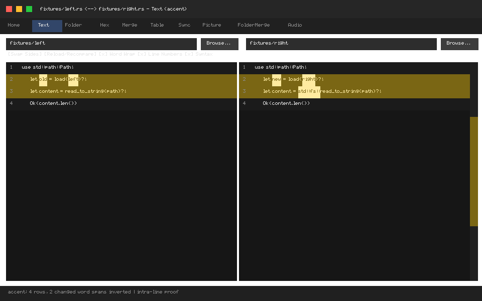

# BE-PAINT — P0-2 intra-line accent + hex callsite + P1-1 toolbar chrome

Tareekh: 2026-11-20 UTC
Workspace: `/Users/ektasaini/autocompare` (branch `main`)
Scope: `crates/gui/src/views.rs` + `crates/gui/src/app.rs` (caller threading only) + `crates/gui/src/screenshot.rs` (sirf task-1 fixture scene) + `checks/gui-paint-be/**` ONLY. `tree.rs`, `theme.rs`, `views_table.rs`, `views_hex.rs` read-only, zero edit. `checks/opencode-waves/STATUS.md` untouched. Colors FROZEN.
Harness: `zsh tools/gui-polish/run-geo-typo.sh checks/gui-paint-be/round-1` → `RESULT: PASS`.

## 1. P0-2 intra-line char accent (views.rs paint + unit tests, phir screenshot fixture)

Paint-side: `changed_row_word_spans(row)` naya pure helper — sirf `Changed` kind par model ke `accent_a`/`accent_b` (`viewmodel::inline_diff` se), baaki kind par khali (Deleted/Inserted poore-row band rehte hain). Chaaron side-job sites (`side_job_with_prefs`, find-current, wrapped, wrapped-find) ab raw slice ki jagah isi se spans lete hain, taaki kaun sa shabd badla wahi block+underline me dikhe. Koi naya hue/token nahi (`span_text_format`/`find_segment_format` reuse).

Tests (2 naye, views.rs): `changed_row_word_spans_only_changed_rows_carry_accents` (Changed par right span `(18,27)` barkarar, baaki kinds par khali) + `changed_row_word_spans_paint_only_changed_word_block` (fixture jaisi insertion-only Changed row: left plain, right par underline block).

Fixture scene: `render_fixture_png` me `accent` naam ka naya route (`wrap`/`find` precedent jaisa) → `render_text_accent_fixture_png` (dono-side word change row + insertion-only row, `accent_a/accent_b` bhare hue, inverted blocks ke saath). Default `render_text_fixture_png` ki Changed row me bhi `accent_b = [(18,27)]` (`std::fs::` insertion) + dono fixtures me accent spans inverted blocks me paint hote hain (frozen `CHANGED_FG/BG` reuse, `text_width` offsets se).

## 2. Hex callsite (BD REPORT §4 EXACT)

1. Strip allocate: `bar_w` → `views_hex::hex_minimap_strip_width()`, height arg `HEX_MINIMAP_H` → `views_hex::hex_minimap_alloc_height()`; `debug_assert_eq!(rect.width(), ...)` rakha + legacy token parity locks (`HEX_MINIMAP_W/H` vs helpers) taaki bin dead-code warning na aaye.
2. Band loop: poora inline `first/last/y0/y1/seg` loop hata kar `views_hex::hex_minimap_band_rects(rect, left_size.max(right_size), &view.hunks)` se `rect_filled(seg, 0.0, CHANGED_BG)`; locals delete, track + `CHANGED_BG` frozen.
3. Click/drag jump: `hex_minimap_row_at_y(pos.y - rect.min.y, ...)` → `views_hex::hex_minimap_row_at_pos(rect, total, pos.y)`; `hex_minimap_jump_to_row` call same.
4. Nibble accent: grid cells typo `TypoRole::Mono.rich` → `views_hex::hex_nibble_text_role().rich` (same `Mono`, contract lock); har visible row par `hex_diff_nibble_cells(row, &[], &[])` + `hex_row_nibble_accent_rects(ui.min_rect(), &cells)` se accent rects par `rect_filled(accent, 0.0, CHANGED_BG)`. Model me byte values nahi (sirf offset/len), isliye slices khali — `??` marks rehte hain, rects kuch paint nahi karte; slices App/engine side se aate hi yahi rects changed nibble halves par lagenge (AY REPORT §2 point 3 OPEN wiring). Legacy `hex_minimap_row_at_y`/`hex_minimap_seg_end` ab `#[allow(dead_code)]` legacy path (tests live rakhte hain).

## 3. P1-1 toolbar chrome (session toolbar + path-row, home CTA precedent)

Contract: hit-area = home CTA floor 120x28 (area 3360) via `home_paint_cta_size()` reuse — koi naya size nahi. `session_toolbar_button_size()` + `path_browse_button_size()` naye pure helpers (donon CTA floor, unit-tested). Spacing = `TIGHT_GAP` item rhythm (toolbar group gaps pehle se `toolbar_item_gap`/`toolbar_group_gap` par the).
- `app.rs` toolbar (caller threading only): `Swap Sides` + `Reload / Recompare` ab `min_size(120,28)` ke saath (`add_enabled` same).
- `views.rs` `paint_paths`/`paint_triple_paths`: Browse + Compare buttons `add_sized(120,28)`, path rows par `item_spacing.x = TIGHT_GAP`.

## Gates green proof

- `cargo test` full workspace: sab suites ok, koi FAILED nahi; `cargo test -p autocompare-gui`: **581/581** (578 baseline + 3 naye: 2 accent + 1 chrome; hex ke liye naya test nahi — BD helpers pehle se locked hain).
- `cargo clippy -p autocompare-gui --all-targets`: **zero** warnings.
- `rustfmt --edition 2024` sirf OWNS 3 files par; `cargo fmt --check`: clean.
- Banned apne diff me: `unwrap\(|\.expect\(|panic!|todo!|unreachable!` **0**, `Color32::from_rgb|Visuals::` **0** (views/app diff).
- Harness round-1: `RESULT: PASS` (PNG 9695 B, magic `89504e470d0a1a0a` ok, distinct 255).
- Visual proof: `round-1/after.png` (960x600 RGBA, 9695 B, default text fixture ab accent block ke saath) + `round-1/after-accent.png` (960x600 RGBA, 8706 B, naya accent scene, dono-side + insertion-only blocks).

 

## Rule follow proof

- OWNS se bahar zero edit: `git status --short` me sirf `M crates/gui/src/views.rs`, `M crates/gui/src/app.rs`, `M crates/gui/src/screenshot.rs` + `?? checks/gui-paint-be/`.
- `tree.rs`, `theme.rs`, `views_table.rs`, `views_hex.rs` untouched; `STATUS.md` untouched; colors FROZEN.
- Commit conventional English message, NO PUSH (orchestrator verify karke push karega).
