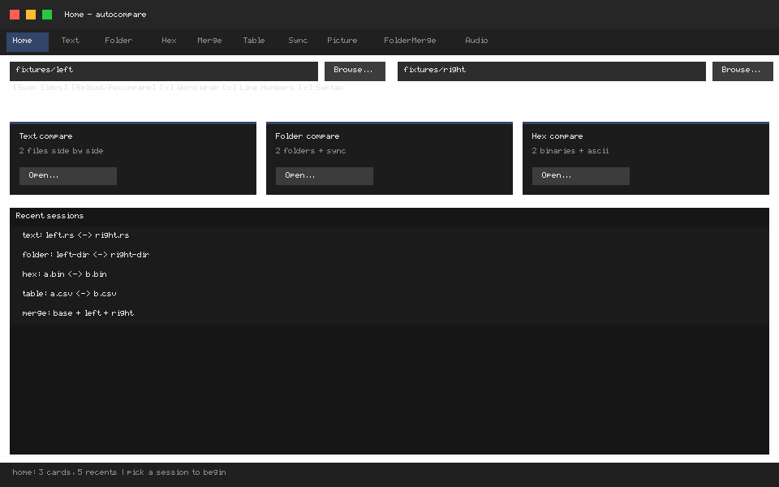
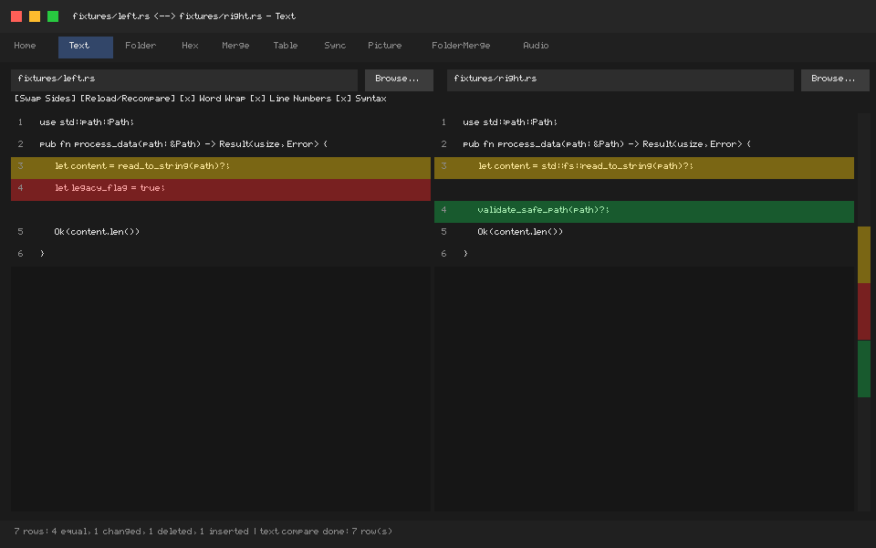
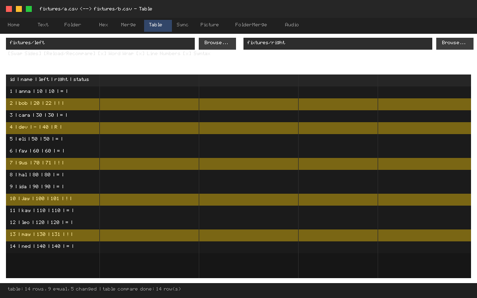
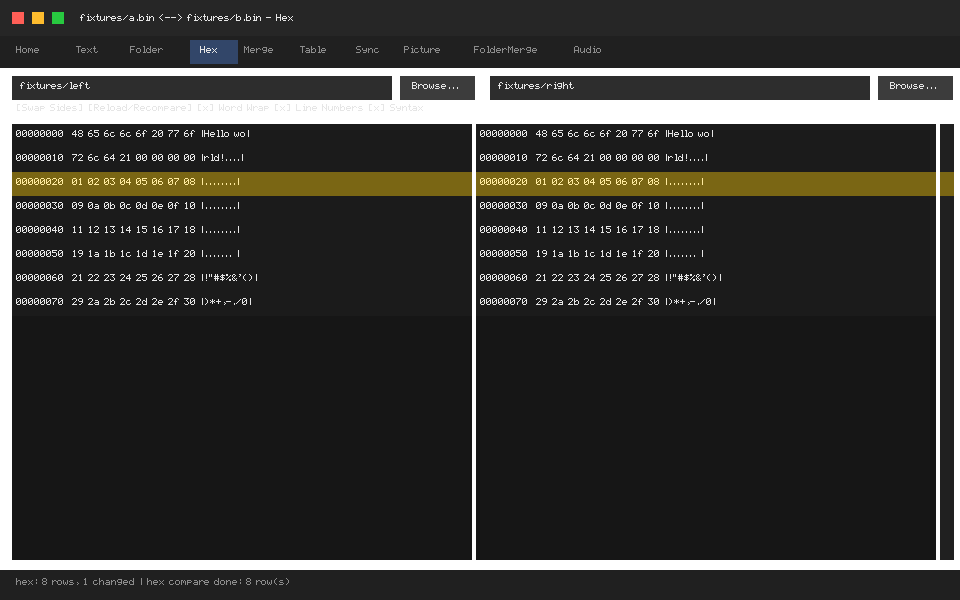

# AU-LOCALRUN — Early Feedback (geometry/typography only, colors out of scope)

Tareekh: 2026-11-20 UTC
Workspace: /Users/ektasaini/autocompare (branch main, pull already up-to-date)
Scope: sirf `checks/localrun-au/**` likha, `crates/**` me zero edit (read-only, dev waves parallel)
Harness: `crates/gui/src/screenshot.rs` (`render_fixture_png` dispatcher) + `crates/gui/src/main.rs --screenshot` (offscreen, koi live window nahi khola)

## 1. Build + screenshot proof

Command 1 — debug build:
```
cargo build -p autocompare-gui
```
Output tail:
```
Finished `dev` profile [unoptimized + debuginfo] target(s) in 0.45s
BUILD_EXIT:0
```
Binary: `target/debug/autocompare-gui`, 72M.

Command 2 — 5 screenshots (file-name routing se view chunta hai):
```
./target/debug/autocompare-gui --screenshot checks/localrun-au/home.png    # HOME:0
./target/debug/autocompare-gui --screenshot checks/localrun-au/text.png    # TEXT:0
./target/debug/autocompare-gui --screenshot checks/localrun-au/folder.png  # FOLDER:0
./target/debug/autocompare-gui --screenshot checks/localrun-au/table.png   # TABLE:0
./target/debug/autocompare-gui --screenshot checks/localrun-au/hex.png     # HEX:0
```

Command 3 — PNG verify:
```
file checks/localrun-au/*.png
```
Sab `PNG image data, 960 x 600, 8-bit/color RGBA, non-interlaced`.
Magic `89504e470d0a1a0a` OK, distinct bytes 256 (blank nahi):

| file | bytes |
|---|---|
| home.png | 9011 |
| text.png | 9624 |
| folder.png | 10068 |
| table.png | 9973 |
| hex.png | 10030 |

Canvas sab me shared: 960x600, TITLE_H 36 + TAB_H 32 + STATUS_H 30, ROW_H 24.

## 2. home.png — Home / session launcher



- Geometry: 3 cards × 304px + 12px gap = 936px avail me fit hai, par Beyond Compare ke launcher se door hai — BC me bada icon + do-line desc + bada action button hota hai, yahan card_h 90px me `Open...` 120x22 button dabaa hua lagta hai, hit-target chhota hai.
- Typography: 5x7 bitmap se `Text compare / 2 files side by side` do lines me padhne layak hai, par title (card) aur desc me size/weight ka farak nazar nahi aata — dono ek jaise weight lagte hain, BC me title bold/proportional hota hai.
- Recent list 24px rows par hai, 5 entries fit hain, par single column `text: left.rs <-> right.rs` hi hai — BC me path + timestamp + session-type columns hote hain, yahan columnar alignment ka koi saboot nahi.
- Path row (`fixtures/left` + `Browse...`) Home par bhi dikhta hai jo BC me nahi hota — Home par path picker ka hona vertical rhythm (150px se pehle 82px chrome) waste karta hai.

## 3. text.png — Text compare (2-pane)



- Geometry: left x12 w460 + gap 4 + right x476 w460 + gutter x940 w14 sahi tikta hai, par gutter 14px BC ke overview ruler se bahut patla hai — changed/deleted/inserted segments 2px min-height par dot jaise lagte hain, click-target nahi lagta.
- Line-number vs content ka gap kam hai (no. x16, text x44 = 28px), BC me number column right-aligned + divider hota hai — yahan `3` aur `let content...` chipke lagte hain, 460px pane me lambi Rust line (`pub fn process_data...`) edge par katne wali hai.
- Typography: 5x7 advance 6px (narrow 4px) + kerning tuck se line fit ho jaati hai, par `std::fs::read_to_string` jaise intra-line change poori row paint se dikhta hai — BC me word/inner accent box hota hai, yahan changed row me shabd-star ka antar nahi dikhta.
- Toolbar `[Swap Sides] [Reload/Recompare] [x] Word Wrap...` ek line me 928px me thusa hai — BC me toolbar grouped buttons + separators hote hain, yahan sab ek baseline par chipka hai.

## 4. folder.png — Folder compare + sync preview


- Geometry: tree panel y158 h260 (10-11 rows capacity) + preview panel 116px + status — BC me tree poori height leta hai aur preview neeche collapsible hota hai, yahan 4 fixture rows ke baad ~200px khaali kaala maidaan hai, khaali jagah ka koi empty-hint geometry nahi.
- Indent: depth*4*7px rule se `src/a.txt` ka indent BC ke tree-indent se kam lagta hai — expand glyph `v` + status glyph `>` + path teeno ek line me bina column divider ke hain, BC me name/size/time alag columns hote hain.
- Typography: filter line `[ ] Hide orphans [ ] Left newer only...` ek 5x7 line me hai, checkbox `[ ]` aur label me sirf 1 space hai — BC me checkbox + label spacing + grouping hoti hai, yahan wrap hone par dusri line counts (`4 entries...`) se takrayegi.
- Sync preview `(Update Both) (Mirror)` + `Apply sync plan` 150x24 button sahi dikhta hai, par consent hint aur summary do 24px lines me chipke hain — BC me mode radio + dry-run list me row-gap hota hai.

## 5. table.png — Table compare (CSV grid)



- Geometry: single pane x12 w936, header 24px + 14 rows × 24px — BC me header row body se uncha/bold hota hai, yahan header bhi 24px hai isliye `id | name | left...` header body rows jaisa lagta hai, header/body ka rhythm alag nahi.
- Column guides x200/400/600/760 fixed hain, content-measured nahi — `1 | anna | 10 | 10 | = |` poori line x20 se start hokar guides ko ignore karti hai, BC me cell padding + column divider per-cell hota hai, yahan `|` char hi divider hai.
- Typography: pipe-separated single string hone se column text vertically align nahi hota (`10 | jay | 100 | 101` me numbers left-aligned hain, BC me numeric right-aligned hote hain) — changed rows poori-row paint hain, cell-level accent ka koi box nahi.
- 14 rows ke baad pane me khaali jagah hai par grid lines neeche nahi badhti — BC me grid viewport tak lines kheenchta hai, yahan column rules sirf content tak dikhte hain.

## 6. hex.png — Hex compare (offset + bytes + ascii)



- Geometry: text wali 460+4+460 chrome reuse sahi hai, par hex line `00000020 01 02 03... |........|` ek string hai — BC me offset / hex-bytes / ascii teen alag columns hote hain, yahan ascii `|...|` bytes se chipka hai, byte-group me extra gap (8+8) ka saboot nahi.
- Changed row (offset 0x20) poori-row paint hai — BC me sirf badle bytes highlight hote hain, yahan kaun sa nibble badla yeh geometry se pata nahi chalta; dono panes me wahi line dikhti hai, left/right byte antar column se nahi dikhta.
- Typography: hex pairs `48 65 6c 6c` me pair-spacing uniform 1 space hai, BC me byte-group rhythm (4/8 grouping + double-space) hota hai — 5x7 mono me `0` vs `O`, `1` vs `l` ka farak kamzor hai, offset `00000010` aur bytes me visual separator nahi.
- Gutter me sirf ek 24px changed block (y+48) hai — 8 rows me 1 changed ke liye theek hai, par BC me hex gutter byte-offset proportional hota hai, yahan text-shape copy hai.

## 7. Rule follow proof

- `git status --porcelain`: sirf `?? checks/localrun-au/` tha, `crates/**` me zero edit.
- Commit sirf `checks/localrun-au/**` stage karke hoga, message `docs(feedback): ...`, NO PUSH (orchestrator karega).
