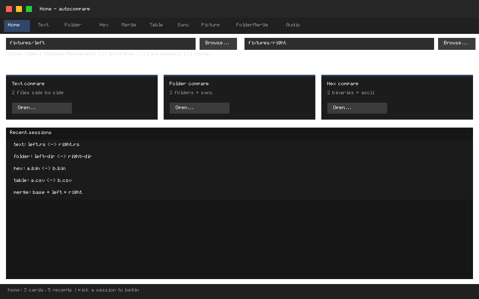
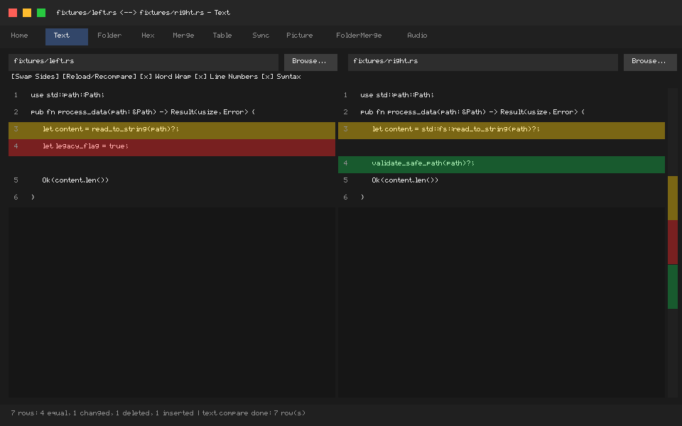
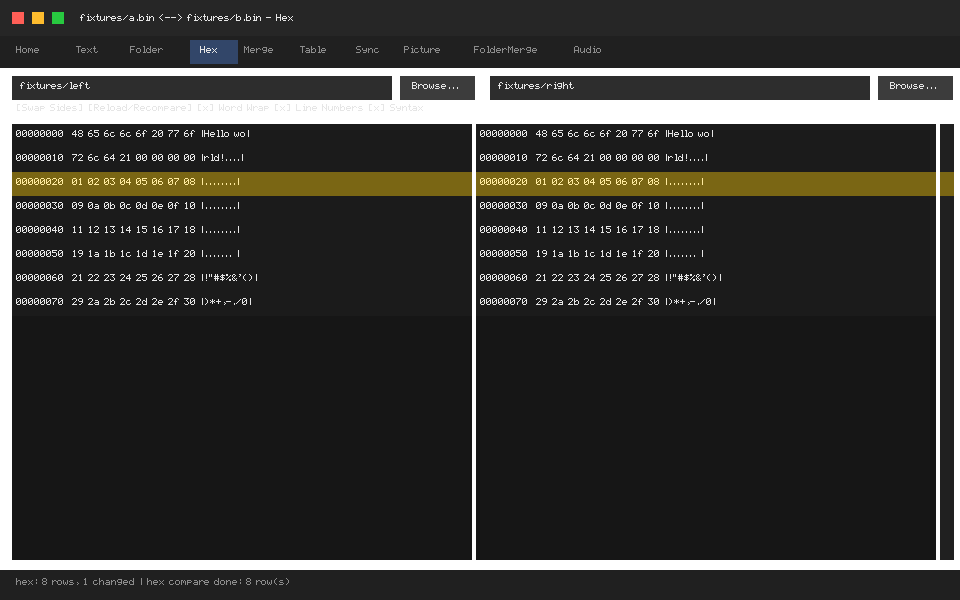

# AW2-LOCALRUN — Early feedback (geometry/typography only, colors out of scope)

Tareekh: 2026-11-20 UTC
Workspace: /Users/ektasaini/autocompare (branch main, pull already up-to-date)
Scope: sirf `checks/localrun-aw2/**` likha, `crates/**` me zero edit (read-only, dev waves parallel)
Harness: `crates/gui/src/screenshot.rs` (`render_fixture_png` dispatcher) + `crates/gui/src/main.rs --screenshot` (offscreen, koi live window nahi khola)

## 1. Build + screenshot proof

Command 1 — debug build:
```
cargo build -p autocompare-gui
```
Output tail:
```
Finished `dev` profile [unoptimized + debuginfo] target(s) in 0.41s
BUILD_EXIT:0
```
Binary: `target/debug/autocompare-gui` (rebuild no-op tha — fingerprint fresh, time 0.41s).

Command 2 — 6 screenshots (file-name routing se view chunta hai; picture probe samet):
```
./target/debug/autocompare-gui --screenshot checks/localrun-aw2/home.png     # HOME:0
./target/debug/autocompare-gui --screenshot checks/localrun-aw2/text.png     # TEXT:0
./target/debug/autocompare-gui --screenshot checks/localrun-aw2/folder.png   # FOLDER:0
./target/debug/autocompare-gui --screenshot checks/localrun-aw2/table.png    # TABLE:0
./target/debug/autocompare-gui --screenshot checks/localrun-aw2/hex.png      # HEX:0
./target/debug/autocompare-gui --screenshot checks/localrun-aw2/picture.png  # route nahi — text fallback (§8)
```

Command 3 — PNG verify:
```
file checks/localrun-aw2/*.png
```
Sab `PNG image data, 960 x 600, 8-bit/color RGBA, non-interlaced`.
Magic `89504e470d0a1a0a` OK, distinct bytes 256 (blank nahi):

| file | bytes |
|---|---|
| home.png | 9011 |
| text.png | 9624 |
| folder.png | 10068 |
| table.png | 9973 |
| hex.png | 10030 |
| picture.png | 9624 (= text.png, fallback) |

Canvas sab me shared: 960x600, TITLE_H 36 + TAB_H 32 + STATUS_H 30, ROW_H 24.

## 2. Headline: AU se byte-identical — harness AV/AW se peeche hai

`md5` AU vs AW2 (paanchon view):

| view | localrun-au | localrun-aw2 | same? |
|---|---|---|---|
| home | 7d9ca87a… | 7d9ca87a… | haan |
| text | 14c01ba2… | 14c01ba2… | haan |
| folder | bb877286… | bb877286… | haan |
| table | 9a7b904f… | 9a7b904f… | haan |
| hex | 70163c4e… | 70163c4e… | haan |

Wajah (read-only check, koi edit nahi): `git log -- crates/gui/src/screenshot.rs` ka aakhri commit `5a0cda0` hai — AU localrun (`700669d`) se pehle ka. `git diff 700669d..HEAD -- crates/gui/src/screenshot.rs` khaali hai. Beech me AV/AW ne live geometry badli:

- `gutter.rs` (+293/-11, `ae79a1a`) — ruler 16/8, min-height 4px, slop
- `home.rs` (+179/-6, `2c53373`) — card/button contract, hierarchy, recent columns
- `views.rs` (+914, `f1a800a` + `58bfb67`) — picture zoom-fit, wrapnav scroll
- `views_table.rs` (+416) — table helpers

Par fixture painter wahi purana hai. Matlab neeche §3–§7 me jo "sudhra / nahi sudhra" hai woh **live-code contract vs stale harness** ka antar hai — screenshots khud me AU ke baad koi sudhaar NAHI dikhate. Yeh harness-sync gap is wave ka sabse bada finding hai.

## 3. home.png — Home / session launcher



- AW2 shot AU jaisa hi hai: 3 cards × 304px + 12px gap, card_h 90px, `Open...` 120x22 button, single-column recent list, Home par path row maujood.
- AV-homegeo (`2c53373`, `checks/gui-homegeo-av/REPORT.md`) ne live contract me sudhaara: button min-h 22→28 (hit area 2640→3360), card min-h 99.6, `HomeTitle` strong-14 vs `HomeDesc` small-weak-11 hierarchy check, recent title+kind(96)+age(72) columns, `HOME_SHOWS_PATH_PICKER = false`. **Par** usi report me saaf likha hai: paint adoption (`views.rs` `paint_home`, `CARD_H`) paint-owner wave ka hai — is wave me nahi hua. Aur harness me to contract bhi nahi pahuncha.
- Natija: BC launcher se doori live-contract star par ghati hai, par paint + harness dono purane dikhte hain. Card title/desc ka weight-antar (§AU-2) screenshots me abhi bhi nazar nahi aata.

## 4. text.png — Text compare (2-pane) + gutter + wrap nav



- Gutter width? **Screenshot me nahi sudhra** — wahi x940 w14 + 2px min-height dots. AW-gutter (`ae79a1a`, `checks/gui-gutter-aw/REPORT.md`) ne `GUTTER_RULER_WIDE 16 / NARROW 8`, `GUTTER_SEGMENT_MIN_H 4.0`, slop ±2px banaye — par sab headless helpers hain; report khud kehta hai `views.rs` me `text_minimap_ruler_width` (12/6 paint width) ko `gutter_ruler_width` (16/8) par switch karna **paint wiring ka kaam hai, is wave me chhua nahi**. Harness to 14px par hi atka hai. Teenon jagah teen widths (harness 14 / paint 12/6 / contract 16/8) — BC overview ruler se doori live me kam hone ki taiyaari hai, dikh abhi bhi nahi raha.
- Wrap nav? Static fixture me find inactive + wrap-off hai, isliye koi visual delta expected hi nahi tha. AW-wrapnav (`58bfb67`) ne `wrap_find_sub_rows` / `wrap_find_scroll_sub` / `wrap_find_jump_visual` + wrap-on loop me exact-sub `want_scroll` guard lagaya (wrap-off path byte-identical, report §Delta). Screenshots is sudhaar ko **prove nahi kar sakte** — harness me wrap-on / find-active scene hi nahi hai.
- Baaki AU points jyon-ke-tyon: line-no vs content gap 28px, lambi Rust line edge par, changed row poori-row paint (intra-line shabd-antar nahi), toolbar ek line me thusa hua.

## 5. folder.png — Folder compare + sync preview


- Byte-identical AU jaisa: tree panel y158 h260, ~200px khaali maidaan bina empty-hint geometry, indent `depth*4*7`, filter line ek line me, consent + summary chipke hue.
- AU-followup waves (folderfilter `06880d4`, syncpaint `4387fd1`, foldersync `01ae605`) live paint me wired hain, par fixture ke 4 static rows + purana paint path wahi dikhata hai. Khaali-jagah ka empty-hint aur name/size/time column divider — harness me abhi bhi door.

## 6. table.png — Table compare (CSV grid)


- Byte-identical AU jaisa: header bhi 24px (body jaisa rhythm), pipe-separated string, guides x200/400/600/760 content-ignorant, grid lines neeche nahi badhti.
- Tablefind (`2dc8705`) + tablekey (`aaba56b`) live me match-spans / key-column affordance laaye, par harness fixture wahi purani pipe-string rows paint karta hai — cell-level accent ka koi box screenshot me nahi dikhta. BC grid se doori barkaraar.

## 7. hex.png — Hex compare (offset + bytes + ascii)



- Byte-identical AU jaisa: offset/bytes/ascii ek string, ascii chipka hua, changed row (offset 0x20) poori-row paint, gutter me wahi ek 24px block.
- Hexgutter (`eb5461b`) live me offset-proportional gutter + click-to-jump laaya, par harness ka gutter abhi bhi text-shape copy hai. Kaun sa nibble badla — geometry se abhi bhi pata nahi chalta.

## 8. picture.png — harness me route HI NAHI (probe)

- `picture.png` ka md5 `text.png` ke baraabar hai — dispatcher me `hex/table/merge/folder/home` branches hain, `picture` ka koi branch nahi, isliye text fixture gira.
- AV-picture (`f1a800a`) live me asli kaam hai: `PICTURE_ZOOM_STEPS`, `picture_fit_zoom_pct`, `picture_center_offset`, step row me `Fit` + 5 presets, chhote content ke liye centered frame. Par offscreen iska **zero coverage** hai — picture fit geometry ka koi PNG saboot maujood harness se nikal hi nahi sakta.
- Agar picture view ka screenshot chahiye to dispatcher me `picture` branch + fixture chahiye — yeh future wave ka kaam hai (yahan sirf report, koi code edit nahi).

## 9. Kya abhi bhi door hai (BC parity, geometry/typo only — colors out of scope)

1. **Gutter teen jagah teen widths**: harness 14px/2px-min, live paint 12/6, naya contract 16/8 + 4px-min + slop. Paint wiring + harness sync dono baaki — BC ruler se doori screenshots me poori barkaraar.
2. **Home**: live contract (28px CTA, hierarchy, columns, no path picker) bana par paint adoption pending (homegeo report khud manta hai); harness usse bhi purana. Card hit-target / title-desc antar / columnar recents — kuch screenshot me nahi dikhta.
3. **Picture fit**: live me centered frame + Fit/steps, par offscreen proof ka rasta nahi. Harness branch chahiye.
4. **Wrap nav**: headless contract + wrap-on scroll fix hua, par fixture me wrap-on/find-active scene nahi — visual proof gap hai.
5. **Table/hex cell-level accent**: kisi AV/AW wave ne haath nahi lagaya — poori-row paint, pipe-string grid, chipki ascii, byte-group rhythm — sab AU jaise door.
6. **Toolbar / path-row chrome**: paanchon shots me wahi thusi toolbar + Home par path picker — harness chrome bhi AV/AW se untouched hai.

## 10. Rule follow proof

- `git status --porcelain`: sirf `?? checks/localrun-aw2/` tha, `crates/**` me zero edit.
- Commit sirf `checks/localrun-aw2/**` stage karke, message `docs(feedback): ...`, NO PUSH.
