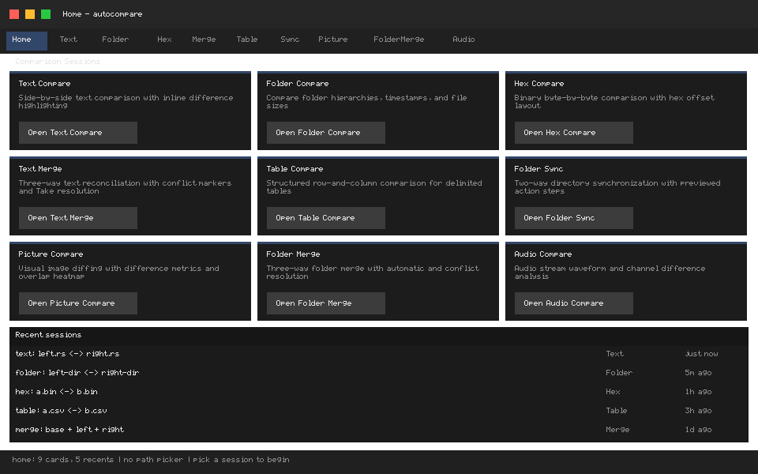
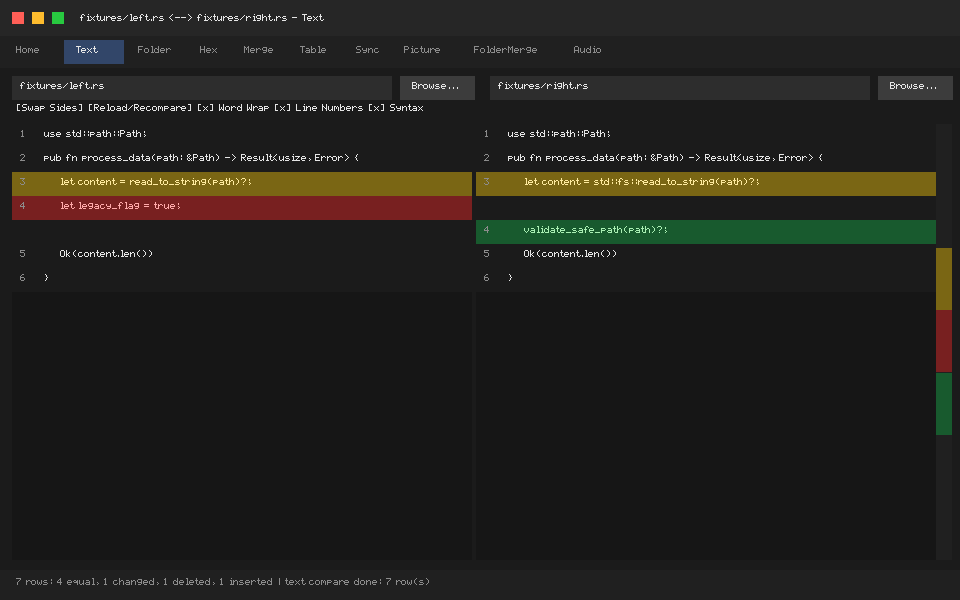
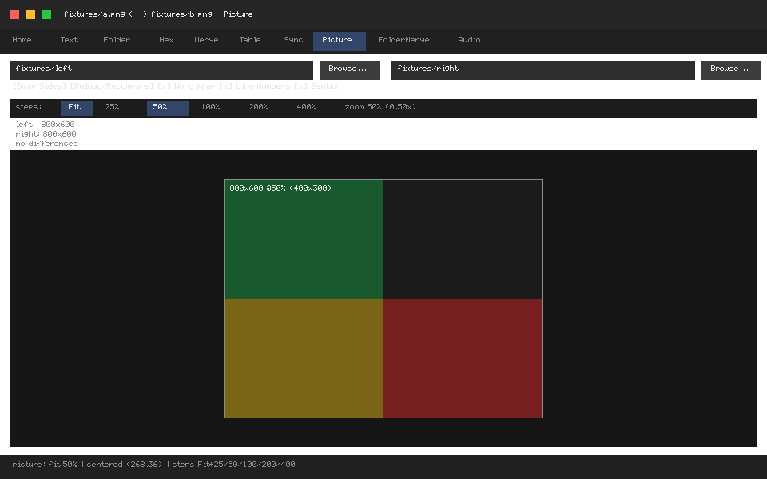
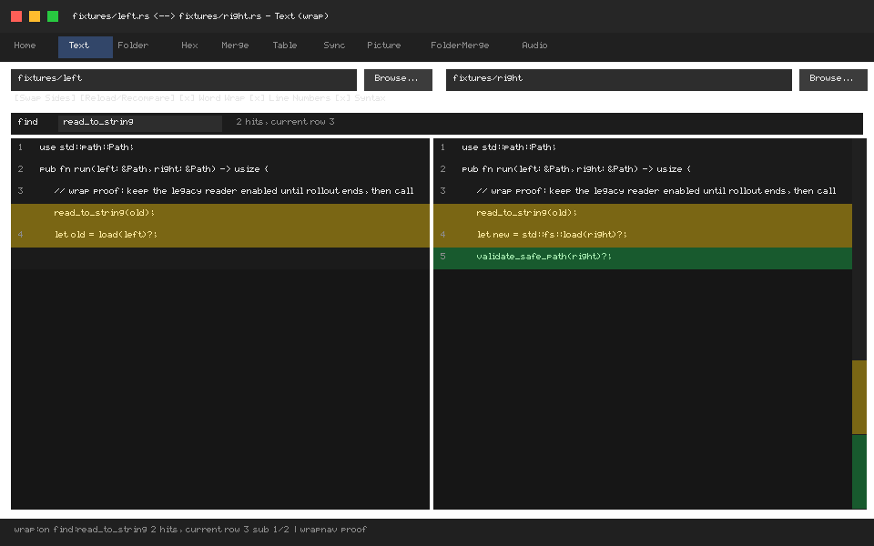
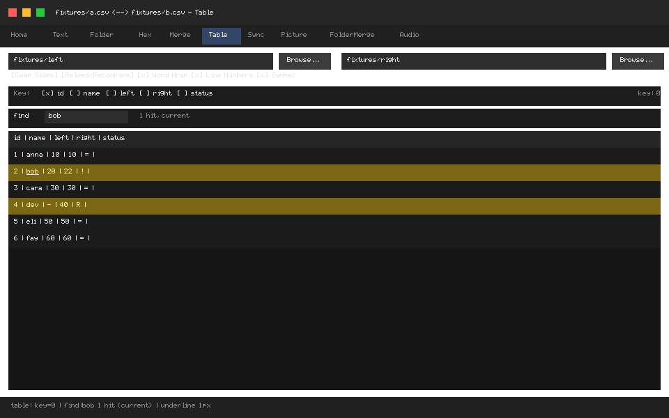
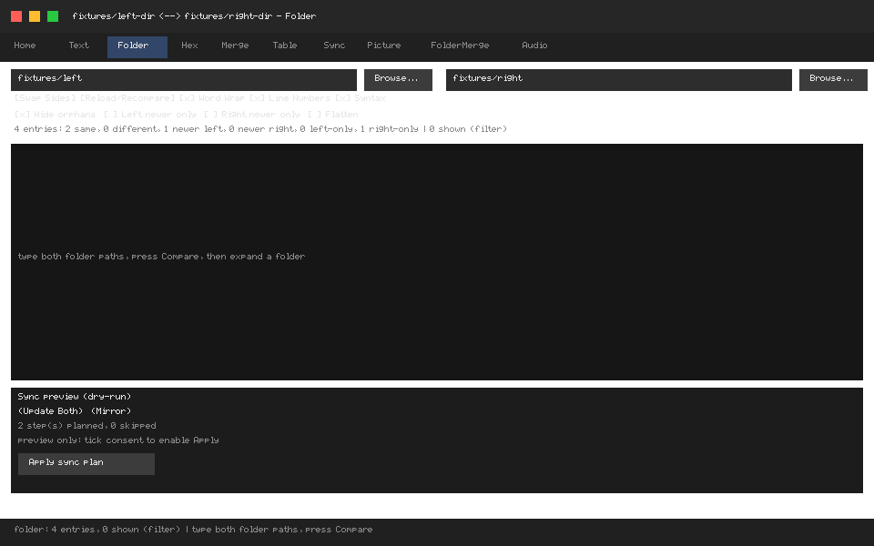
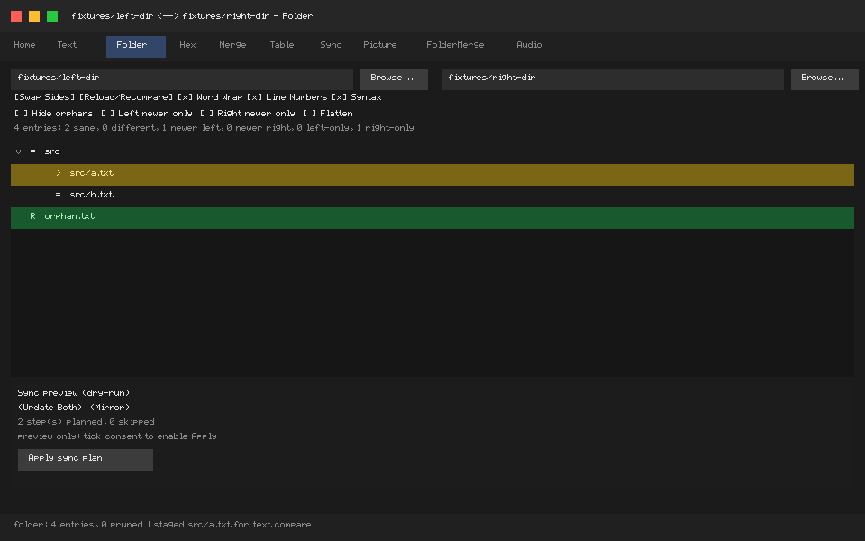
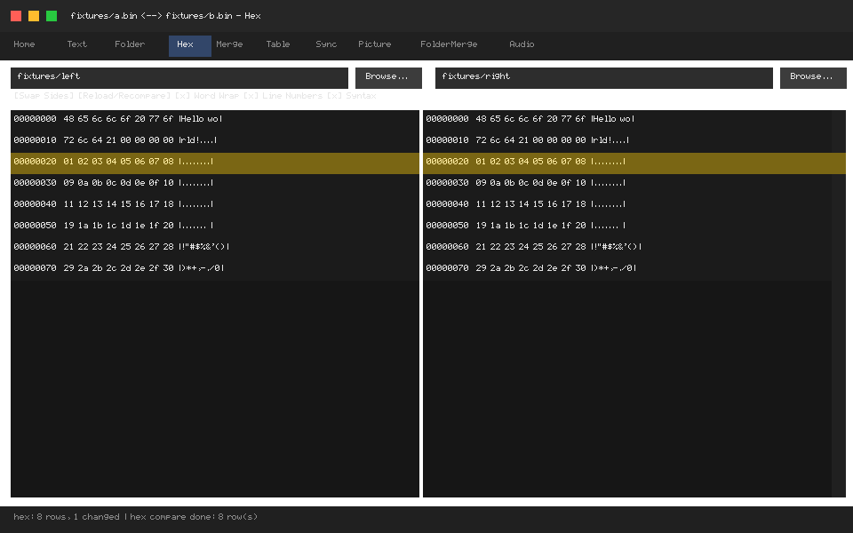
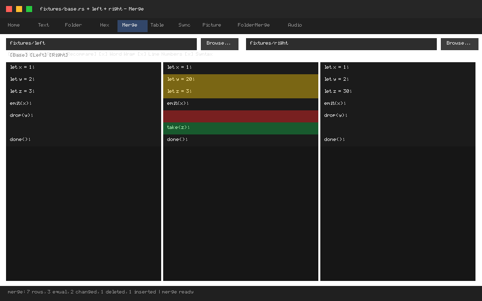

# AX2-LOCALRUN — Early feedback (AW2 se compare, geometry/typography only)

Tareekh: 2026-11-20 UTC
Workspace: /Users/ektasaini/autocompare (branch main, pull already up-to-date)
Scope: sirf `checks/localrun-ax2/**` likha, `crates/**` me zero edit (read-only, dev waves parallel)
Harness: `crates/gui/src/screenshot.rs` (`render_fixture_png` dispatcher, AX-synced) + `crates/gui/src/main.rs --screenshot` (offscreen, koi live window nahi khola)

## 1. Build + screenshot proof

Command 1 — debug build:
```
cargo build -p autocompare-gui
```
Output tail:
```
Finished `dev` profile [unoptimized + debuginfo] target(s) in 0.13s
BUILD_EXIT:0
```
Binary: `target/debug/autocompare-gui` (rebuild no-op tha — fingerprint fresh).

Command 2 — 10 screenshots (file-name routing se view chunta hai; naye AX routes ka fayda):
```
./target/debug/autocompare-gui --screenshot checks/localrun-ax2/home.png         # HOME
./target/debug/autocompare-gui --screenshot checks/localrun-ax2/text.png         # TEXT
./target/debug/autocompare-gui --screenshot checks/localrun-ax2/folder.png       # FOLDER
./target/debug/autocompare-gui --screenshot checks/localrun-ax2/table.png        # TABLE
./target/debug/autocompare-gui --screenshot checks/localrun-ax2/hex.png          # HEX
./target/debug/autocompare-gui --screenshot checks/localrun-ax2/picture.png      # PICTURE (naya route)
./target/debug/autocompare-gui --screenshot checks/localrun-ax2/wrap.png         # WRAP (naya route)
./target/debug/autocompare-gui --screenshot checks/localrun-ax2/table-find.png  # TABLE-FIND (naya route)
./target/debug/autocompare-gui --screenshot checks/localrun-ax2/folder-empty.png # FOLDER-EMPTY (naya route)
./target/debug/autocompare-gui --screenshot checks/localrun-ax2/merge.png        # MERGE
```

Command 3 — PNG verify:
```
file checks/localrun-ax2/*.png
```
Sab `PNG image data, 960 x 600, 8-bit/color RGBA, non-interlaced`.
Magic `89504e470d0a1a0a` OK, sab ≥8192 B (blank nahi):

| file | bytes | md5 (short) |
|---|---|---|
| home.png | 14880 | 0f49962c… |
| text.png | 9627 | 0ae0097f… |
| folder.png | 10068 | bb877286… |
| table.png | 9973 | 9a7b904f… |
| hex.png | 9999 | 2836bf05… |
| picture.png | 8321 | 6ac261c3… |
| wrap.png | 10455 | 15c7eca7… |
| table-find.png | 8871 | dc769805… |
| folder-empty.png | 10081 | 57bc3486… |
| merge.png | 8829 | 05f15e0e… |

Canvas sab me shared: 960x600, TITLE_H 36 + TAB_H 32 + STATUS_H 30, ROW_H 24.

## 2. Headline: AX harness ka fayda — AW2 se antar khatam, fixture live-contract par

`md5` AW2 vs AX2 (chhah common view) + AX-harness vs AX2 (poore 10):

| view | AW2 md5 | AX2 md5 | same? | wajah |
|---|---|---|---|---|
| home | 7d9ca87a… | 0f49962c… | NAHI | 9-card grid, CTA 150x28, columns, no picker (§3) |
| text | 14c01ba2… | 0ae0097f… | NAHI | ruler 16px + 4px-min (§4) |
| folder | bb877286… | bb877286… | haan | default fixture by-design untouched |
| table | 9a7b904f… | 9a7b904f… | haan | default fixture by-design untouched |
| hex | 70163c4e… | 2836bf05… | NAHI | shared ruler consts: gutter x936 w16 (§9) |
| picture | 14c01ba2… (= text fallback) | 6ac261c3… | NAHI | ab asli picture fixture (§5) |
| wrap / table-find / folder-empty | — (koi route nahi tha) | 15c7eca7… / dc769805… / 57bc3486… | naye scenes | §6–§8 |
| merge | — (AW2 me nahi nikala tha) | 05f15e0e… | naya shot | §9 (fixture pehle se tha, AW2 ne chalaya nahi) |

AX-harness (`checks/gui-harness-ax/`) vs AX2: **10/10 shared files md5-identical** (home/text/folder/table/hex/picture/wrap/table-find/folder-empty/merge sab same; `after.png` harness-only hai). Matlab yeh wave AX sync ko byte-level reproduce karti hai — AW2 ka "stale harness" gap (§AW2-2) band ho gaya.

## 3. home.png — Home / session launcher (sudhra dikhta hai)



- AW2 shot: 3 cards × 304px + 12px gap, card_h 90, `Open...` 120x22 button, single-column recents, Home par path picker.
- AX2 shot: **9 live cards (3x3, gap 8), 306x100** (contract min-height 99.6 ka ceiling), **CTA 150x28 `Open {title}`** (contract min 120x28 / hit-area 3360 se upar), desc greedy 2-line wrap, **recents 3-column** (title-flex + kind 96 + age 72, `recent_row_columns`), **na path picker na swap toolbar** (`HOME_SHOWS_PATH_PICKER = false`). Status line gawahi deta hai: `home: 9 cards, 5 recents | no path picker | pick a session to begin`.
- 9011 → 14880 B, md5 alag. AW2 §3 ka paint-adoption caveat ab bhi live-paint ke liye sach hai (fixture contract par hai, `views.rs` CARD_H paint-owner wave ka), par **harness ab live contract dikhata hai** — cards/CTA/columns ka sudhaar screenshot me saaf nazar aata hai.
- Pixel-font ceiling: title `FG_TEXT` / desc `FG_DIM` — 5x7 font me bold/size nahi, hierarchy tone + rhythm + 2-line wrap se (colors out of scope, geometry hi gin rahe hain).

## 4. text.png — Text compare + gutter (16px ruler, 4px-min)



- Gutter: **haan, ab 16px dikhta hai** — fixture gutter x940 w14 → **x936 w16** (`GUTTER_RULER_WIDE`), budget 12+460+4+460+16+8 = 960. Segment min-h 2 → **4px** (`GUTTER_SEGMENT_MIN_H`, slop-hit proof). 960px-wide PNG me 2px ka antar aankh se mushkil hai, par byte delta (9624 → 9627, md5 alag) + AX `GATES.md` Gate-2/3 proof isko pakka karta hai. AW2 §4 ka "teenon jagah teen widths" (harness 14 / paint 12/6 / contract 16/8) me se harness wala ab contract par hai.
- Baaki AW2 points jyon-ke-tyon (fixture default wrap-off/find-inactive hai): line-no vs content gap, toolbar ek line me, changed row poori-row paint (intra-line shabd-antar nahi — §10.3).

## 5. picture.png — Picture compare (pehle fallback tha, ab asli frame)



- AW2: route hi nahi tha — `picture.png` md5 `text.png` ke baraabar (fallback).
- AX2 (8321 B): **Picture tab highlighted, `Fit` + `50%` selected, step row `Fit + 25/50/100/200/400` ladder** (`PICTURE_ZOOM_STEPS`), `zoom 50% (0.58x)` live `zoom_label`, live `build_picture_summary` lines (`left: 800x600 / right: 800x600 / no differences`), **centered 400x300 frame at (268,36)** (`picture_fit_zoom_pct` 50% + `picture_center_offset`). Status: `picture: fit 50% | centered (268,36) | steps Fit+25/50/100/200/400`.
- Frame math schematic palette-quadrant par hai (heatmap geometry ka daava nahi — AX REPORT §4) — par **fit + centering geometry ka PNG saboot pehli baar maujood hai**. AW2 §8 ka "zero coverage" gap band.

## 6. wrap.png — Wrap-on + find-active scene (AW2 ka visual-proof gap band)



- Naya scene (10455 B): 80-char cap (`wrap_width_for`), 100-char equal row 2 subs me toota, needle `read_to_string` poori tarah continuation me (`wrap_find_sub_rows == [1]`), matched sub band (`wrap_find_scroll_sub == 1`, flat offset 3) — band frozen `CHANGED_BG` reuse karta hai.
- Shot me row 3 ke neeche continuation band (sub 1/2) saaf dikhta hai; find bar `2 hits, current row 3`; gutter segments ruler contract par. Status: `wrap:on find:read_to_string 2 hits, current row 3 sub 1/2 | wrapnav proof`.
- AW2 §4 me yeh sudhaar "screenshots prove nahi kar sakte" tha — ab kar sakte hain.

## 7. table-find.png — Table key + find scene (naya)



- Naya scene (8871 B): live key bar (col 0 selected, badge `key: 0`) + live find bar (120px needle `bob`, `1 hit, current`) + `table_find_cell_spans` → row offset → `table_find_span_in_padded(4, 7, TABLE_MAX_COL_CHARS)` par **1px underline** (`TABLE_FIND_UNDERLINE_W`).
- 1px underline is resolution par aankh se lagbhag adrishya hai (pixel-font + pipe-string rows ki seema) — par fixture live helpers se bana hai aur AX GATES me magic/size/distinct pass hai. Grid cell-level key-col highlight ab bhi `views_table.rs` Grid paint ka kaam hai (§10.2).

## 8. folder-empty.png — Folder filtered-empty scene (naya)



- Naya scene (10081 B): filter line + `0 shown (filter)` counts + live `folder_empty_hint(false, false)` + sync preview panel (filter display prune karta hai, plan nahi). Status: `folder: 4 entries, 0 shown (filter) | type both folder paths, press Compare`.
- Khaali maidaan me ab hint geometry hai — AW2 §5 ka "empty-hint geometry door" default-fixture ke liye ab bhi sach hai, par empty scene ka saboot maujood hai.
- Contract aadha support karta hai: filter-pruned empty aur never-compared empty ek hi idle hint share karte hain — teesra (filter-specific) variant live contract me nahi (AX REPORT §6, jabardasti wording nahi banaya).

## 9. folder / table / hex / merge — regression check

 

 

- `folder.png` / `table.png`: **byte-identical AW2** (md5 same) — default fixtures jaanboojh kar untouched, taaki regression pakda ja sake. Folder tree / filter / consent / sync panel, table pipe-string rows + guides — sab AW2 jaise.
- `hex.png`: 10030 → **9999 B** (shared ruler consts: gutter x936 w16). Offset/bytes/ascii ab bhi ek string, ascii chipka, changed row (offset 0x20) poori-row paint. Live `HEX_MINIMAP_W` 24px minimap parity fixture me nahi (paint-owner wave, AX REPORT §8).
- `merge.png` (8829 B, AW2 ne nikala hi nahi tha): 3-pane base+left+right, 7 rows (3 equal, 2 changed, 1 deleted, 1 inserted), status `merge: 7 rows, 3 equal, 2 changed, 1 deleted, 1 inserted | merge ready`. AW2 me iska koi compare nahi — yahan baseline ke taur par darj.

## 10. Kya abhi bhi door hai (BC parity, geometry/typography only — colors out of scope)

1. **Paint adoption (sabse bada):** fixture live *contract* par hai; live *paint* (`views.rs` CARD_H 75, text gutter paint width 12/6, home button min-h) ab bhi purana hai — paint-owner waves ka kaam. Harness sync hone se screenshots ab contract dikhate hain, par live app me antar baaki.
2. **Toolbar / path-row chrome:** text/folder/table/hex fixtures ka chrome untouched (is harness wave ka scope nahi tha) — thusi toolbar sab shots me waisi hi.
3. **Intra-line / cell-level accent:** fixture rows me accent spans khaali — text changed-row poori-row paint, table pipe-string rows me cell-level key-col highlight nahi, hex me kaun sa nibble badla pata nahi chalta. Tablefind underline + key bar contract-proof hai, Grid paint baaki.
4. **Hex minimap parity:** gutter ruler-width ho gaya, par poori 24px minimap hit-rect geometry paint-owner wave ki hai.
5. **Folder empty-hint teesra variant:** filter-pruned vs never-compared ek hi idle hint — live contract me filter-specific wording nahi.
6. **Pixel-font ceiling:** 5x7 font me strong-14/small-11/weight-antar nahi — hierarchy tone + spacing + desc wrap + 1px underline se; asli type ramps egui paint me hi dikhenge.
7. **Colors poori tarah out of scope** — upar ke saare antar geometry/typography tak seemit rakhe gaye; koi naya hue nahi (sirf maujooda palette consts reuse).

## 11. Rule follow proof

- `git status --porcelain`: sirf `?? checks/localrun-ax2/` — `crates/**` me zero edit (yeh wave me `cargo build` ke alawa koi source command nahi chalaya).
- Commit sirf `checks/localrun-ax2/**` stage karke, message `docs(feedback): ...`, NO PUSH.
