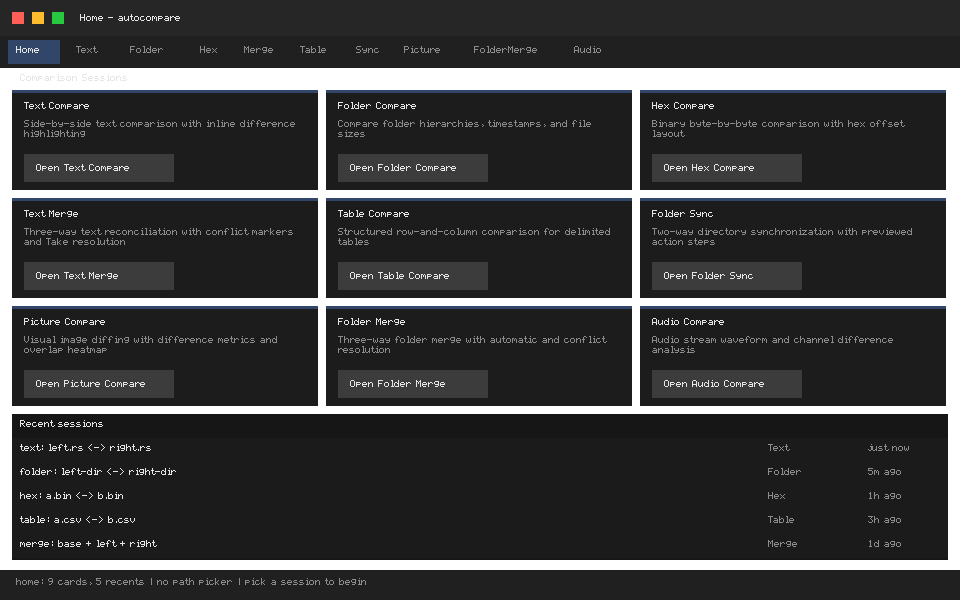

# BB-LOCALRUN — Early feedback (BB state, BC parity re-check vs AX2 S10)

Tareekh: 2026-11-20 UTC
Workspace: /Users/ektasaini/autocompare (branch main, pull already up-to-date)
Scope: sirf `checks/localrun-bb/**` likha, `crates/**` me zero edit (read-only, dev waves parallel)
Harness: `tools/gui-polish/run-geo-typo.sh` + `target/debug/autocompare-gui --screenshot` (offscreen, koi live window nahi khola)

## 1. Build + harness proof

Command 1 — harness (build + text-fixture shot + gui tests + geo-typo signals):
```
zsh tools/gui-polish/run-geo-typo.sh checks/localrun-bb/round-1
```
Output: `RESULT: PASS` (exit 0). Signals:
- geometry: `Grid::10`, `text_style_height x4`, 25 width calls, add_space none
- typography: `monospace x53`, `strong x23`, `small x50`, `.size` values `['14.0']`
- colors untouched check: info only (colors out of scope, koi paint edit nahi)

Command 2 — 5 scenes (file-name routing se view chunta hai):
```
./target/debug/autocompare-gui --screenshot checks/localrun-bb/round-1/after.png              # TEXT (harness ne banaya)
./target/debug/autocompare-gui --screenshot checks/localrun-bb/round-1/after-table.png        # TABLE
./target/debug/autocompare-gui --screenshot checks/localrun-bb/round-1/after-folder.png       # FOLDER
./target/debug/autocompare-gui --screenshot checks/localrun-bb/round-1/after-home.png         # HOME
./target/debug/autocompare-gui --screenshot checks/localrun-bb/round-1/after-folder-empty.png # FOLDER-EMPTY
```

Command 3 — read-only test suite (koi edit nahi, sirf run):
```
cargo test -p autocompare-gui  # 569 passed, 0 failed
```

## 2. PNG verify (magic + size + dimensions)

Sab `PNG image data, 960 x 600, 8-bit/color RGBA, non-interlaced`.
Magic `89504e470d0a1a0a` OK, sab >= 8192 B, distinct 256 (blank nahi):

| file | bytes | md5 (short) | AX2 twin | same? |
|---|---|---|---|---|
| after.png (text) | 9627 | 0ae0097f | text.png 0ae0097f | haan |
| after-table.png | 9973 | 9a7b904f | table.png 9a7b904f | haan |
| after-folder.png | 10068 | bb877286 | folder.png bb877286 | haan |
| after-home.png | 14880 | 0f49962c | home.png 0f49962c | haan |
| after-folder-empty.png | 10081 | 57bc3486 | folder-empty.png 57bc3486 | haan |

5/5 byte-identical AX2. Ye expected hai: BB waves ne `views.rs` (live paint) + `tree.rs` (classifier) badla, `screenshot.rs` (headless fixture renderer) ko chhua nahi. Headless PNG pixel-proof nahi de sakta paint adoption ka — regression-absence ka proof deta hai.

 



## 3. Kaun se gaps CLOSE hue (code evidence, read-only verify — pixels nahi)

G1. Table grid / cell accents — CLOSED (paint side, headless pixels by-design same):
- P3 data-grid live hai `views.rs` me: `views_table::TABLE_CELL_GRID_ID` (line 2064), indexed `table_row_cells` loop + `paint_table_data_cell` (line 2104), `table_data_index_map` fwd/rev map (lines 1399/1924), find-source switch `table_find_match_rows(&data_cells...)` (line 1909 aas-paas).
- P4 overlays live hain: `table_key_box_rects` -> `rect_stroke` (lines 2136-2138), `table_find_underline_rects_for_cell` -> `line_segment` (lines 2157-2163).
- Proof: `cargo test` 569 green (BB se +1 test `tablep34_data_index_map_skips_header_rows`), clippy/fmt GATES me pass (BB REPORT).
- Headless `after-table.png` AX2 jaisa hai kyunki fixture ab bhi pipe-string rows + guides banata hai — Grid paint sirf live egui me dikhta hai.

G2. Typo roles — CLOSED (paint side):
- `views.rs` me `TypoRole` ke 78 uses (grep count): `HomeTitle`/`HomeDesc`/`HomeButton` card sites (lines 413/416/425), `Mono` panes (line 650 aas-paas: text/hex/merge/table glyph), `Small` captions (line 1200 aas-paas pager/summary/note sites). Purane `.monospace()`/`.small()`/`.size()` paint se hatae gaye (BB REPORT: koi `.size(` add nahi).
- Note: headless 5x7 font me 12px/11px role antar nahi dikhta — `after*.png` same rehna sahi hai.

G3. Folder 3rd variant — HEADLESS CLOSED, PAINT WIRING OPEN (neeche P0 dekho):
- `tree.rs` me live hai: `FolderEmptyState::AllSame` (line 477), `folder_all_same` (line 526), `folder_empty_state_full_rows` (line 539, `visible == 0 && all_same` -> `AllSame`), wording `"folder: folders match — all same, nothing to sync"` (line 569) + 2 naye tests green.
- Par paint wiring abhi nahi hui: `folder_paint_empty_hint_full_rows` / `folder_empty_hint_full_rows` ka `views.rs`/`app.rs` me koi use nahi (grep empty) — BB-FOLDER3 REPORT ke patch spec 1/2 + 2/2 owner wave ka wait kar rahe hain.

## 4. Baaki gaps — rank + agle wave ka OWNS file

P0-1. Folder AllSame paint wiring (identical-filtered case me galat hint: "clear filters" jabki clear karne par bhi kuch karne ko nahi):
- Kaam: BB-FOLDER3 REPORT patch spec 1/2 (`views.rs` me `folder_paint_empty_hint_full_rows`) + 2/2 (`app.rs` me `folder_empty_state_full_rows` + `folder_empty_hint_full_rows`) adopt karo, legacy glyph-blind path frozen rakhte hue + test update (`Some(NoMatch)` -> `Some(AllSame)` single-`=` + Different-filter case me).
- OWNS: `views.rs` + `app.rs` (paint-owner wave; `tree.rs` FROZEN).

P0-2. Text intra-line char accent (changed row ab bhi poori-row paint; kaun sa shabd badla pata nahi — core BC parity antar):
- Kaam: `accent_a`/`accent_b` spans fixture me ab bhi khaali hain (`screenshot.rs` lines 218-228 `Vec::new`), paint full-row band karta hai. Pehle paint-side word spans lao, phir fixture scene (wrap/find jaisa naya route) se visual proof do.
- OWNS: `views.rs` paint (pehle), `screenshot.rs` fixture scene (baad me, alag wave).

P1-1. Toolbar / path-row chrome (text/folder/table/hex sab shots me thusi toolbar — AX2 S10.2 se unchanged):
- Kaam: session toolbar + path row chrome ko contract par lao (spacing, button hit-areas, home CTA precedent jaisa).
- OWNS: `views.rs` chrome block (paint-owner wave).

P1-2. Hex parity: 24px minimap hit-rect + nibble-level accent (gutter ruler-width ho gaya, minimap + kaun sa nibble badla ab bhi nahi):
- Kaam: live `HEX_MINIMAP_W` 24px minimap geometry + ascii-chipka + changed-nibble accent paint me.
- OWNS: `views_hex.rs` + `views.rs` paint callsite.

P1-3. Home CARD_H paint adoption (contract min-height 99.6/100 vs paint purana 75 — AX2 S10.1 ka hissa, BB ne nahi chhua):
- Kaam: `views.rs` CARD_H + home button min-h ko contract par lao.
- OWNS: `views.rs` home block.

P2-1. Pixel-font ceiling (5x7 headless font me strong/small/weight antar nahi; 1px underline + hierarchy tone/spacing se kaam chal raha):
- Ye code gap nahi, harness limit hai. Asli type ramps sirf live egui paint me dikhenge. Koi OWNS file nahi — future egui-paint wave me visual check.

Colors: poori tarah out of scope (is wave me koi hue/token edit nahi, FROZEN).

## 5. Rule follow proof

- `git status --porcelain`: sirf `?? checks/localrun-bb/` (rounds ke `.out`/geo-report stage nahi — sirf `REPORT.md` + `round-1/after*.png` commit).
- `crates/**` me zero edit (sirf `cargo build`/`cargo test`/screenshot binary chalaya).
- `checks/opencode-waves/STATUS.md` untouched (orchestrator-owned).
- Colors FROZEN (koi palette/Visuals edit nahi).
- Commit conventional English message, NO PUSH (orchestrator verify + push karega).
