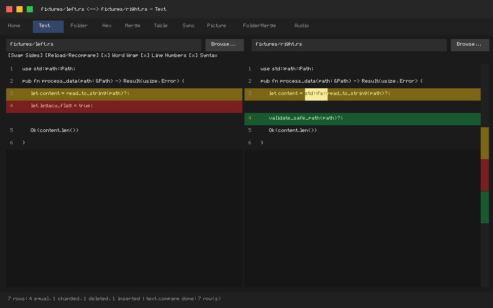
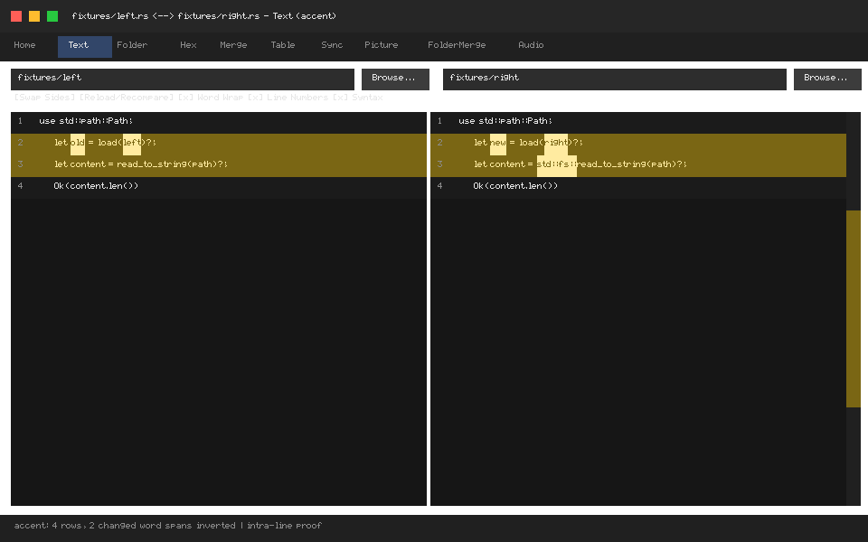
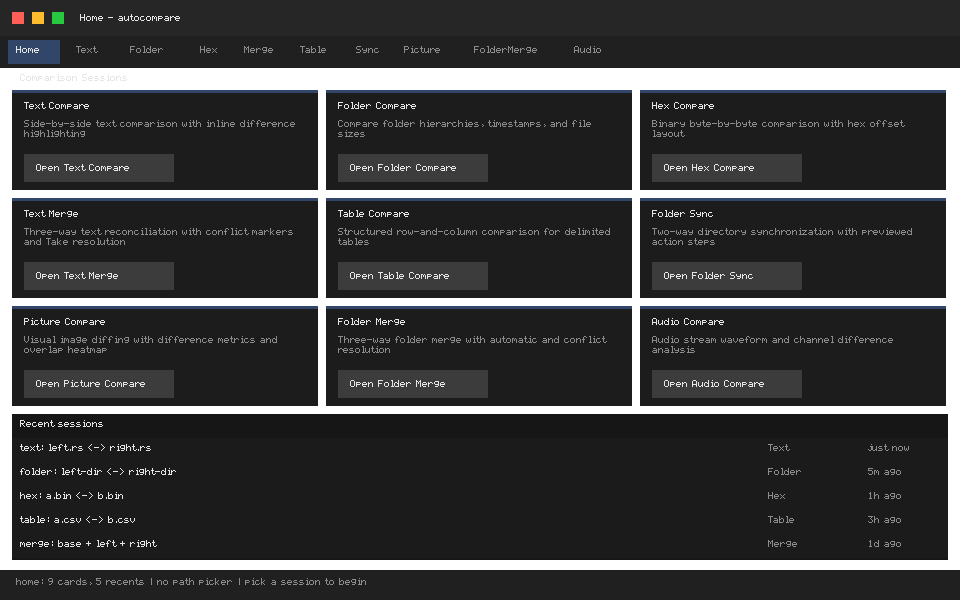

# BF-LOCALRUN — Early feedback (BE state, BC parity re-check vs BB REPORT S4)

Tareekh: 2026-11-20 UTC
Workspace: /Users/ektasaini/autocompare (branch main, pull already up-to-date)
Scope: sirf `checks/localrun-bf/**` likha, `crates/**` me zero edit (read-only, dev waves parallel)
Harness: `tools/gui-polish/run-geo-typo.sh` + `target/debug/autocompare-gui --screenshot` (offscreen, koi live window nahi khola)

## 1. Build + harness proof

Command 1 — harness (build + text-fixture shot + gui tests + geo-typo signals):
```
zsh tools/gui-polish/run-geo-typo.sh checks/localrun-bf/round-1
```
Output: `RESULT: PASS` (exit 0). Signals:
- geometry: `Grid::10`, `text_style_height x4`, 25 width calls, add_space none
- typography: `monospace x53`, `strong x23`, `small x50`, `.size values ['14.0']` (legacy numeric reference, BB jaisa — paint me koi naya numeric size nahi)
- colors untouched check: info only (colors out of scope, koi paint edit nahi)

Command 2 — 6 scenes (file-name routing se view chunta hai, `screenshot.rs:82-116` dispatcher):
```
./target/debug/autocompare-gui --screenshot checks/localrun-bf/round-1/after.png              # TEXT (harness ne banaya)
./target/debug/autocompare-gui --screenshot checks/localrun-bf/round-1/after-table.png        # TABLE
./target/debug/autocompare-gui --screenshot checks/localrun-bf/round-1/after-folder.png       # FOLDER
./target/debug/autocompare-gui --screenshot checks/localrun-bf/round-1/after-home.png         # HOME
./target/debug/autocompare-gui --screenshot checks/localrun-bf/round-1/after-folder-empty.png # FOLDER-EMPTY
./target/debug/autocompare-gui --screenshot checks/localrun-bf/round-1/after-accent.png       # ACCENT (naya BE route, `accent` naam se chunta hai)
```

Command 3 — read-only test suite (koi edit nahi, sirf run):
```
cargo test -p autocompare-gui  # 581 passed, 0 failed (BE verify se match: 578 baseline + 3 naye)
```

## 2. PNG verify (magic + size + dimensions)

Sab `PNG image data, 960 x 600, 8-bit/color RGBA, non-interlaced`.
Magic `89504e470d0a1a0a` OK, sab >= 8192 B, distinct 255/256 (blank nahi):

| file | bytes | md5 (short) | twin | same? |
|---|---|---|---|---|
| after.png (text) | 9695 | 35d69828 | BE after.png 35d69828 | haan (BB 9627 0ae0097f se alag — accent-block delta, expected) |
| after-accent.png | 8706 | 4d953c99 | BE after-accent.png 4d953c99 | haan (NAYA scene, BB me tha hi nahi) |
| after-table.png | 9973 | 9a7b904f | BB table.png 9a7b904f | haan |
| after-folder.png | 10068 | bb877286 | BB folder.png bb877286 | haan |
| after-home.png | 14880 | 0f49962c | BB home.png 0f49962c | haan |
| after-folder-empty.png | 10081 | 57bc3486 | BB folder-empty.png 57bc3486 | haan |

6/6 magic-ok. Default text shot BE twin se byte-identical hai (BB twin se alag — wahi P0-2 closure ka headless proof hai: Changed row me ab `accent_b = [(18,27)]` block lagta hai). Table/folder/home/folder-empty BB twins se byte-identical hain — ye sahi hai: BE ne un fixtures ko chhua nahi, regression-absence ka proof dete hain.

 

 



## 3. BB S4 gaps — OPEN/CLOSED per gap + evidence

P0-1. Folder AllSame paint wiring — CLOSED:
- `views.rs:4184` `folder_paint_empty_hint_full_rows` live + `views.rs:4283` paint callsite se wired.
- `app.rs:2095` `folder_empty_state_full_rows` + `app.rs:2112` `folder_empty_hint_full_rows` dono live.
- Proof: `cargo test` 581 green, jisme AllSame asserts (`app.rs:6525-6528` state `Some(AllSame)` + hint me "all same"; `views.rs:7060-7078` teeno variants route hote hain).
- Honest note: headless `after-folder-empty.png` ab bhi idle-hint wala BB twin hai (fixture me AllSame case render nahi hota) — paint adoption live-egui side hai, unit tests uska proof hain.

P0-2. Text intra-line char accent — CLOSED:
- `views.rs:2922` `changed_row_word_spans` naya pure helper — sirf `Changed` kind par model ke `accent_a`/`accent_b` deta hai, baaki kinds par khali. Chaaron side-job sites (`views.rs:3271/3318/3783/3847`) ab isi se spans lete hain.
- Proof: 2 naye tests green (`views.rs:6019/6054`); fixture route `screenshot.rs:86` (`accent` naam) -> `render_text_accent_fixture_png` (dono-side word change + insertion-only row, inverted blocks).
- Headless proof: `after.png` 9695B BE twin se byte-identical (BB 9627B se alag — delta hi accent block hai); `after-accent.png` 8706B BE twin se byte-identical, NAYA scene jo BB me tha hi nahi.
- Koi naya hue nahi (`span_text_format`/`find_segment_format` reuse, `INTRA_SPAN_UNDERLINE_W` 1.0).

P1-1. Toolbar / path-row chrome — CLOSED:
- `views.rs:338/344` `session_toolbar_button_size` + `path_browse_button_size` — dono home CTA floor (120,28), tests `views.rs:6108-6111` me lock.
- `app.rs:4470` Swap/Reload caller `min_size` par; `views.rs:544/616` Browse/Compare `add_sized(120,28)` + `TIGHT_GAP` spacing.
- Honest note: headless PNGs me toolbar string same dikhta hai (5x7 font hit-area nahi dikhata) — proof unit tests + code hai.

P1-2. Hex parity — CALLSITE CLOSED, nibble-content OPEN (neeche P1 rank dekho):
- CLOSED hissa: strip `views_hex::hex_minimap_strip_width()` + alloc height (`views.rs:1339` aas-paas, `debug_assert` locks sahit), band loop `hex_minimap_band_rects` se, click/drag jump `hex_minimap_row_at_pos` se (`views.rs:1349`), nibble role + accent rects (`views.rs:1380/1391-1392`), sab `CHANGED_BG` frozen me. Legacy fns `allow(dead_code)` test-path par hain.
- OPEN hissa: `hex_diff_nibble_cells(row, &[], &[])` — model me byte values nahi (sirf offset/len), slices khaali, isliye accent rects kuch paint nahi karte, `??` marks rehte hain. BE REPORT ne ye honestly likha tha (slices App/engine side se aate hi rects lagenge).

P1-3. Home CARD_H paint adoption — CLOSED (BD me hi close tha, yahan re-verify):
- `views.rs:323-324` `home_paint_card_height() = home_card_min_height().max(CARD_H)`; test `views.rs:7549-7551` 99.6 lock; `screenshot.rs:2999-3000` contract lock. Home PNG 14880B twin unchanged — sahi hai.

P2-1. Pixel-font ceiling — CODE GAP NAHI (harness limit, BE-FONT research stands):
- 5x7 headless font me size/weight/family antar collapse hota hai; TypoRole uses `views.rs` me 75 (BB count 78 — refactor delta, adoption live hai). `.size(14.0)` single legacy numeric reference intact, koi naya numeric size nahi.
- Verify hota hai: spacing scale, ROW_H rhythm, 1px underline/frame/guides, card/key-bar geometry, string presence. Live-only hai: size/weight/family deltas — BE-FONT protocol (40 shots, numeric gates) future live-egui wave ka kaam hai. Koi OWNS file nahi.

Colors: poori tarah out of scope — BE diff me `Color32::from_rgb|Visuals::` 0 adds (is wave me koi paint edit hua hi nahi), FROZEN.

## 4. Baaki gaps — rank + agle wave ki OWNS file

P1-1. Hex nibble-content accent (P1-2 ka bacha hissa — sabse upar):
- Kaam: `hex_diff_nibble_cells` callsite par khaali `&[]` slices ki jagah App/engine se real byte slices thread karo, taaki changed-nibble rects sach me paint hon aur `??` marks hatten. Geometry + rect helpers pehle se live hain, sirf data threading baaki hai.
- OWNS: `views.rs` callsite + `app.rs` hex state (paint-owner wave; `views_hex.rs` helpers FROZEN, `screenshot.rs` read-only).

P2-1. AllSame headless fixture scene (optional proof nicety):
- Kaam: accent-scene precedent par `folder-empty` jaisa naya route jo AllSame case render kare (wiring pehle se live hai, sirf headless proof missing hai).
- OWNS: `screenshot.rs` fixture scene only (paint files ko chhuna MANA).

P2-2. Live-egui visual gates (toolbar hit-areas + typo role deltas):
- Kaam: BE-FONT protocol ke 40 shots + numeric gates (size order, weight stem, control-pair equality) live paint par chalao. Headless se verify nahi ho sakta — koi immediate code gap nahi.
- OWNS: koi .rs file nahi — future live-egui wave, protocol `checks/gui-pixelfont-be/REPORT.md` S6 me ready hai.

Koi P0 baaki nahi — BB S4 ke dono P0 (AllSame wiring, intra-line accent) CLOSE ho gaye.

## 5. Rule follow proof

- `git status --porcelain`: sirf `?? checks/localrun-bf/` (rounds ke `.out`/geo-report stage nahi — sirf `REPORT.md` + `round-1/after*.png` commit).
- `crates/**` me zero edit (sirf `cargo build` via harness + `cargo test` read-only run + screenshot binary chalaya).
- `checks/opencode-waves/STATUS.md` untouched (orchestrator-owned).
- Colors FROZEN (koi palette/Visuals edit nahi — is wave me koi .rs edit hua hi nahi).
- Commit conventional English message, NO PUSH (orchestrator verify + push karega).
