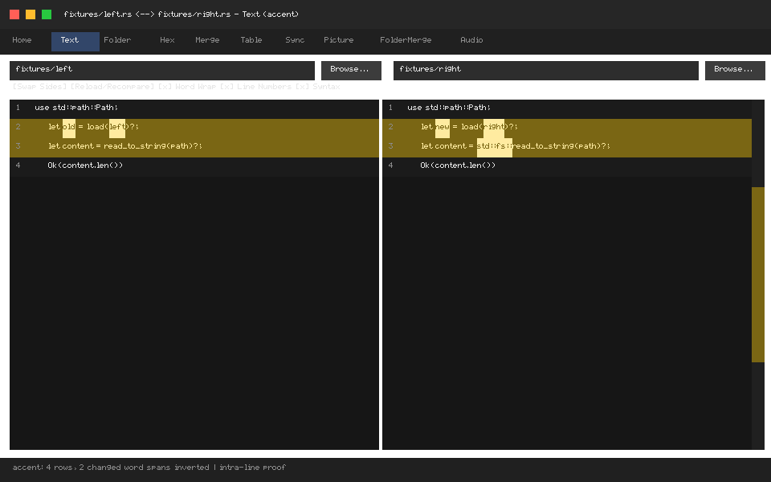
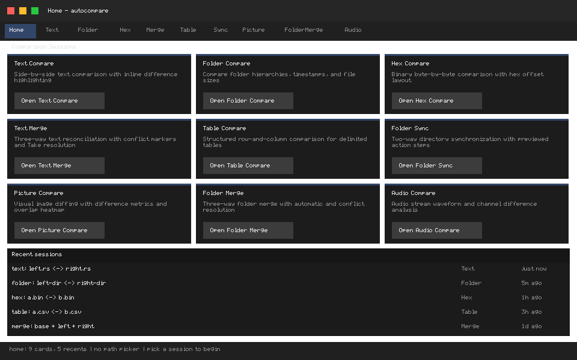
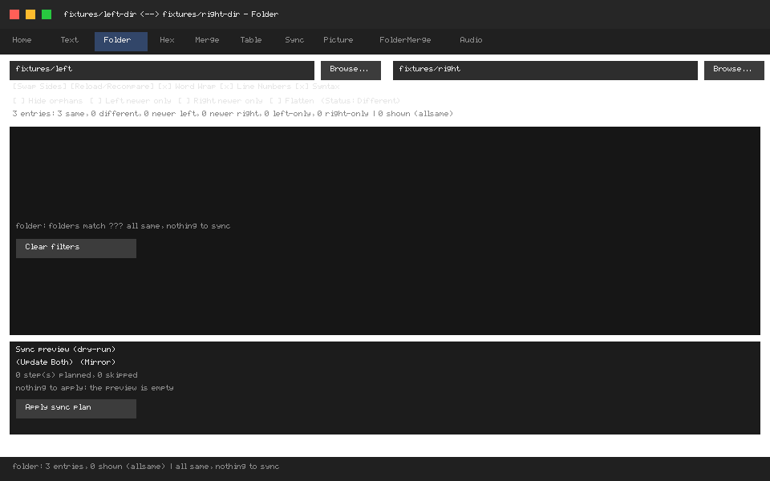
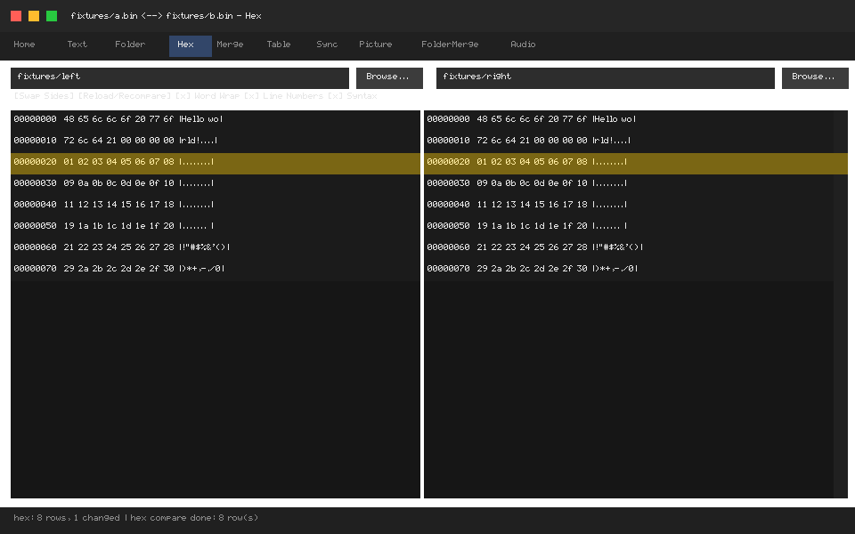
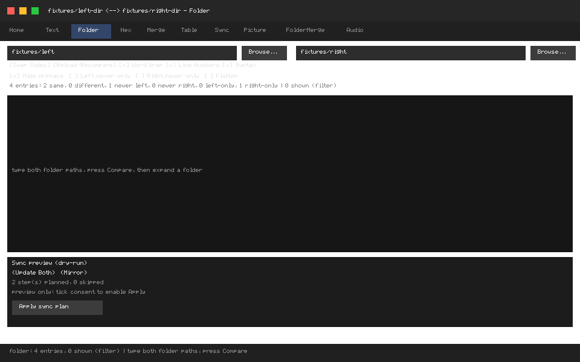

# BH-LOCALRUN — Early feedback (BG state, BC parity re-check vs BF REPORT S3/S4)

Tareekh: 2026-11-19 UTC
Workspace: /Users/ektasaini/autocompare (branch main, pull already up-to-date)
Scope: sirf `checks/localrun-bh/**` likha, `crates/**` me zero edit (read-only, dev waves parallel)
Harness: `tools/gui-polish/run-geo-typo.sh` + `target/debug/autocompare-gui --screenshot` (offscreen, koi live window nahi khola)
BG base: `37d6234` (AllSame fixture route) + `685d9ad` (hex byte-slice threading) + `72c9778` (STATUS wave-BG-complete)

## 1. Build + harness proof

Command 1 — harness (build + text-fixture shot + gui tests + geo-typo signals):
```
zsh tools/gui-polish/run-geo-typo.sh checks/localrun-bh/round-1
```
Output: `RESULT: PASS` (exit 0). Signals BF se exact-match:
- geometry: `Grid::10`, `text_style_height x4`, 25 width calls, add_space none
- typography: `monospace x53`, `strong x23`, `small x50`, `.size values ['14.0']` (legacy numeric reference, koi naya numeric size nahi)
- colors untouched check: info only (colors out of scope, is wave me koi paint edit hua hi nahi — mera run read-only tha)

Command 2 — 8 scenes (file-name routing se view chunta hai, `screenshot.rs:82-121` dispatcher):
```
./target/debug/autocompare-gui --screenshot checks/localrun-bh/round-1/after.png              # TEXT (harness ne banaya)
./target/debug/autocompare-gui --screenshot checks/localrun-bh/round-1/after-table.png        # TABLE
./target/debug/autocompare-gui --screenshot checks/localrun-bh/round-1/after-folder.png       # FOLDER
./target/debug/autocompare-gui --screenshot checks/localrun-bh/round-1/after-home.png         # HOME
./target/debug/autocompare-gui --screenshot checks/localrun-bh/round-1/after-folder-empty.png # FOLDER-EMPTY
./target/debug/autocompare-gui --screenshot checks/localrun-bh/round-1/after-accent.png       # ACCENT (`accent` naam se route)
./target/debug/autocompare-gui --screenshot checks/localrun-bh/round-1/after-allsame.png     # ALLSAME (NAYA BG route, `allsame` naam se route: `screenshot.rs:90-92`)
./target/debug/autocompare-gui --screenshot checks/localrun-bh/round-1/after-hex.png          # HEX (BG-nibble period ka fixture route, `hex` naam se route: `screenshot.rs:93-95`)
```

Command 3 — read-only test suite (koi edit nahi, sirf run):
```
cargo test -p autocompare-gui  # 589 passed, 0 failed (BF 581 + 8 naye = 5 nibble BG + 3 allsame BG; commit messages se match)
```

## 2. PNG verify (magic + size + dimensions)

Sab `PNG image data, 960 x 600, 8-bit/color RGBA, non-interlaced`.
Magic `89504e470d0a1a0a` OK, sab >= 8192 B, distinct 255/256 (blank nahi):

| file | bytes | md5 (short) | twin | same? |
|---|---|---|---|---|
| after.png (text) | 9695 | 35d69828 | BF after.png 35d69828 | haan (regression-absence) |
| after-accent.png | 8706 | 4d953c99 | BF after-accent.png 4d953c99 | haan |
| after-table.png | 9973 | 9a7b904f | BF table.png 9a7b904f | haan |
| after-folder.png | 10068 | bb877286 | BF folder.png bb877286 | haan |
| after-home.png | 14880 | 0f49962c | BF home.png 0f49962c | haan |
| after-folder-empty.png | 10081 | 57bc3486 | BF folder-empty.png 57bc3486 | haan |
| after-allsame.png | 10264 | 36adfef2 | BG-allsame proof 36adfef2 | haan (NAYA BG scene, BF me tha hi nahi) |
| after-hex.png | 9999 | 2836bf05 | BG-nibble proof 2836bf05 | haan (BF me tha hi nahi, BG-twin stable) |

8/8 magic-ok. 6 BF twins byte-identical (koi regression nahi), 2 BG proofs byte-identical (deterministic re-run).

 

 

 

 

## 3. BF S3/S4 gaps — OPEN/CLOSED per gap + evidence

BF P0-1 (Folder AllSame paint wiring) — CLOSED (re-verify):
- BF me hi close tha; 589 green me AllSame asserts ab bhi pass (`app.rs` state + `views.rs` `_full_rows` asserts, BG-allsame REPORT me padosi-suites green darj).
- Naya headless proof is wave me mila: `after-allsame.png` 10264B BG proof se byte-identical — scene sach me render hota hai, teeno purane folder scenes se byte-distinct.

BF P0-2 (Text intra-line char accent) — CLOSED (re-verify):
- `after.png` 9695B + `after-accent.png` 8706B dono BF twins se byte-identical — regression-absence proof. 589 green me dono accent tests pass.

BF P1-1 (Toolbar / path-row chrome) — CLOSED (re-verify):
- Koi toolbar-string drift nahi (home/table/folder PNGs BF twins se identical); hit-area proof unit tests me hai, headless font hit-area nahi dikhata (BF honest note stands).

BF P1-2 (Hex parity) — DATA-THREADING CLOSED, grid-text OPEN (neeche P1 rank dekho):
- CLOSED hissa: `685d9ad` me App-owned `HexByteSnap` + capped readers + lifecycle wipe + `views.rs:1397` callsite par REAL slices (`left_slice`/`right_slice`) vs `(&[], &[])` fallback. 5 naye tests 589 me green. Mera read-only grep: `hex_diff_nibble_cells` callsite `views.rs:1397` par real-slice args ke saath maujood hai.
- Nibble `??` marks GAYE? — NAHI, grid text me ab bhi rehte hain: BG-nibble REPORT S4 honest note ke mutabiq `format_hex_grid_cells` sirf offset/len se banta hai aur us wave ka OWNS callsite-only tha — uska signature chhuna scope-bahar tha. Real slices milte hi accent *rects* changed nibble halves par lagte hain (live `paint_hex` path, headless me nahi chalta: headless me koi real compare nahi chalta, snap `None` = purana fallback). Isliye `after-hex.png` 9999B BG-twin-stable hai — regression-absence proof hai, accent ka visual proof nahi. Visual proof unit tests + code hain.
- AllSame scene proof MILA? — HAAN: `after-allsame.png` 10264B, BG proof `36adfef2` se byte-identical, deterministic re-run. `screenshot.rs:90-92` dispatcher route live hai.

BF P1-3 (Home CARD_H paint adoption) — CLOSED (re-verify):
- Home PNG 14880B BF twin se identical — sahi hai, fixture ko chhua nahi.

BF P2-1 (Pixel-font ceiling) — CODE GAP NAHI (stands):
- Signals BF se exact-match (monospace x53, strong x23, small x50, `.size ['14.0']`); headless 5x7 me size/weight/family antar collapse hota hai. Live-only deltas BE-FONT protocol ka kaam hain. Koi OWNS file nahi.

Colors: poori tarah out of scope — is wave me koi `.rs` edit hua hi nahi (read-only run), FROZEN.

## 4. Baaki gaps — rank + agle wave ki OWNS file

P1-1. Hex grid-cell `??` text -> real hex digits (BF P1-2 ka bacha hissa — sabse upar):
- Kaam: `format_hex_grid_cells` (offset/len-only) ko real byte content dikhana; accent-rect plumbing pehle se live hai, sirf grid text baaki hai. BG-nibble ne scope-bahar bataya tha, ab yahi agla paint wave hai.
- OWNS: `views_hex.rs` grid-text scope + `screenshot.rs` fixture read (paint-owner wave; `views.rs` callsite + `app.rs` snap FROZEN-good).

P1-2. Live-egui hex accent visual gate (real-files compare -> rects land):
- Kaam: live paint par do alag bytes wali files ka compare chala kar changed-nibble rects ka visual gate lo. Headless se verify nahi ho sakta (snap `None` rehta hai) — koi immediate code gap nahi.
- OWNS: koi .rs file nahi — future live-egui wave.

P2-1. Live-egui visual gates (toolbar hit-areas + typo role deltas):
- Kaam: BE-FONT protocol ke 40 shots + numeric gates live paint par chalao. BF se carry, headless se verify nahi ho sakta.
- OWNS: koi .rs file nahi — future live-egui wave, protocol `checks/gui-pixelfont-be/REPORT.md` S6 me ready hai.

Koi P0 baaki nahi — BF ke dono P0 CLOSE hain, BG ke dono items (nibble threading, allsame scene) CLOSE + headless re-verify ho gaya.

## 5. Rule follow proof

- `git status --porcelain`: sirf `?? checks/localrun-bh/` (rounds ke `.out`/geo-report stage nahi — sirf `REPORT.md` + `round-1/after*.png` commit).
- `crates/**` me zero edit (sirf `cargo build` via harness + `cargo test` read-only run + screenshot binary chalaya).
- `checks/opencode-waves/STATUS.md` untouched (orchestrator-owned).
- Colors FROZEN (koi palette/Visuals edit nahi — is wave me koi .rs edit hua hi nahi).
- Commit conventional English message, NO PUSH (orchestrator verify + push karega).
